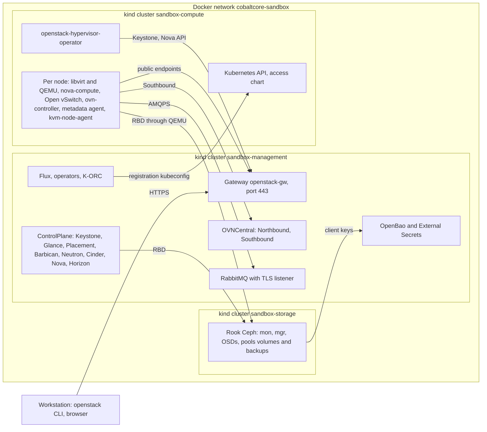

# CobaltCore OpenStack Sandbox

A modular sandbox for evaluating the parts of
[CobaltCore OpenStack](https://github.com/C5C3/cobaltcore) on a single Linux
host. It rebuilds the lab of the upstream
[Quick Start (metal-stack)](https://c5c3.github.io/cobaltcore/quick-start-metal-stack.html) on
[kind](https://kind.sigs.k8s.io/) clusters instead of a Gardener shoot, and
splits it across three clusters: one for management and control plane, one for
storage, one for compute.

The idea for this sandbox and its implementation come out of the
[IPCEI-CIS Hackathon Potsdam](https://apeirora.eu/content/news/apeirora-ipcei-cis-hackathon/)
of the IPCEI-CIS and NeoNephos community, November 24 to 26, 2026.

> **Status: milestones 0 to 2 and 4 built.** The scaffold of milestone 0,
> the control plane of milestone 1, the orders of milestone 2 and the
> hypervisor of milestone 4 are implemented, and milestones 3 and 5 to 7
> are specification.
> This README describes what is to be built, which upstream material it builds
> on, and which points have to be proven first. It was written against
> `C5C3/cobaltcore` at `15a0323e` and `C5C3/playground` at `d2e6b596`
> (both 2026-11-24). Statements marked *upstream* are taken from those
> sources. Everything else is the design of this sandbox and is unverified
> until the milestone that builds it has run.

## Contents

- [Goals](#goals)
- [Non-goals](#non-goals)
- [What upstream provides](#what-upstream-provides)
- [Target topology](#target-topology)
- [Cluster roles](#cluster-roles)
- [Networking and addresses](#networking-and-addresses)
- [Interfaces between the clusters](#interfaces-between-the-clusters)
- [Deployment model](#deployment-model)
- [Modules](#modules)
- [Profiles](#profiles)
- [Orders](#orders)
- [External storage and external compute](#external-storage-and-external-compute)
- [Repository layout](#repository-layout)
- [Planned command surface](#planned-command-surface)
- [Host requirements](#host-requirements)
- [Footprint](#footprint)
- [Milestones](#milestones)
- [Points to prove first](#points-to-prove-first)
- [Design decisions](#design-decisions)
- [References](#references)

## Goals

1. **The metal-stack quick start on kind.** One `ControlPlane` resource runs
   Keystone, Glance, Placement, Barbican, Neutron on OVN, Cinder on Ceph, Nova
   and Horizon. KVM hypervisors boot servers, attach RBD volumes, live-migrate,
   get evicted, and volumes are backed up, restored and survive a key rotation.
   The acceptance test of the full build is Part 1 and Part 2 of that quick
   start, run against the sandbox.
2. **Dedicated clusters per role.** Management and control plane share one
   kind cluster. Storage (Ceph) and compute (hypervisors) each get a kind
   cluster of their own and attach to the control plane over the interfaces a
   real site would use.
3. **Modular.** Every part is a module that can be enabled, left out or
   replaced, so a single part can be evaluated without the rest: only the
   identity service, the control plane without compute, Cinder on Ceph without
   hypervisors, and so on.
4. **Single replicas.** No high availability in the first build: one pod per
   component, the `Minimal` sizing profile, one Ceph monitor.
5. **Orders.** The order mechanism of the
   [Quick Start (Orders)](https://c5c3.github.io/cobaltcore/quick-start-orders.html) is usable: a service
   owner orders Keystone, MariaDB and RabbitMQ pieces from an assigned
   namespace on the management cluster.
6. **External storage and external compute, later.** Once the initial build
   stands, a Ceph cluster and a compute cluster that the sandbox does not
   create can be registered in place of, or beside, the kind ones. The
   initial build must not block this: the clusters talk to each other only
   through addresses and credentials that an external cluster can use too.
7. **A 16 GiB host where possible.** The profiles up to `full` aim at a host
   with 16 GiB of memory. Everything that costs memory and is not needed for
   the part under evaluation is a switch. See [Footprint](#footprint).

## Non-goals

- High availability, production sizing, or a hardened security posture. The
  sandbox runs privileged pods, a private CA and lab credentials.
- Surviving a host reboot or a Docker restart. kind does not keep node
  addresses stable, and Ceph monitors and the registration kubeconfigs depend
  on them. The sandbox is rebuilt, not repaired.
- macOS and Windows hosts. The design relies on the host and all clusters
  sharing one routable Docker network and on `/dev/kvm`.
- Gardener and metal-stack specifics of the upstream lab: the `shoot-info`
  ConfigMap, Lightbits volumes, the public internet address.
- A dedicated network cluster. OVN chassis run on the compute nodes, as in
  the upstream lab. Gateway nodes and a BGP fabric can become a module later.
- Glance on RBD and Nova ephemeral disks on RBD. *Upstream* supports Ceph for
  Cinder volumes and backups only; Glance stays on the Garage S3 store and
  instance disks on `qcow2`.
- Orders on a target cluster, Part 2 of the upstream orders quick start.
  Owners' namespaces live on the management cluster.
- Continuous image automation, load tests, chaos tests and Tempest runs as the
  playground operates them. They can be added as modules once the build
  stands.

## What upstream provides

The sandbox composes upstream material and adds only what kind and the split
across clusters need.

| Source | What the sandbox takes from it |
| --- | --- |
| [Quick Start (ControlPlane)](https://c5c3.github.io/cobaltcore/quick-start-controlplane.html) | The `ControlPlane` and `OVNCentral` resources, the `Minimal` sizing, the database tenant onboarding, the verification steps. It runs everything on one kind cluster behind `*.127-0-0-1.nip.io:8443` |
| [Quick Start (metal-stack)](https://c5c3.github.io/cobaltcore/quick-start-metal-stack.html) | The lab to rebuild: public Gateway on port 443 with a lab CA, Rook Ceph with the pools `volumes` and `backups`, Cinder RBD backend and backup target, libvirt DaemonSet, `OVNChassis`, `NeutronMetadataAgent`, `NovaCompute`, openstack-hypervisor-operator (hvo) and kvm-node-agent (kna). It runs everything in one cluster |
| [Quick Start (Orders)](https://c5c3.github.io/cobaltcore/quick-start-orders.html) | The seven order kinds and the namespace assignment of its Part 1. Its Part 2, orders on a second cluster, is not built |
| [Connect a Compute Cluster](https://c5c3.github.io/cobaltcore/guides/nova/connect-a-compute-cluster.html) | The contract for hypervisors on another cluster than the control plane: what the ControlPlane delivers, what the compute cluster has to provide |
| [Target Clusters](https://c5c3.github.io/cobaltcore/reference/target-clusters.html) and [Deploy to a Target Cluster](https://c5c3.github.io/cobaltcore/guides/deploy-to-a-target-cluster.html) | The `target-cluster-access` chart, the registration Secret, `spec.targetClusterRef` |
| `deploy/bases` and `deploy/overlays` of `C5C3/cobaltcore` | The reusable Flux stages (`operators`, `tls`, `shared-openbao`, `eso-store`, `controlplane-operator`), the development sizing in `bases/devstack`, and the lab manifests under `overlays/metal-stack` |
| [C5C3/playground](https://github.com/C5C3/playground) | The repository shape: Flux stages per cluster under `clusters/`, upstream included at `vendor/cobaltcore`, bootstrap steps as Jobs, a validation script, decisions recorded as ADRs |

Four facts from upstream shape the design:

- **The split across clusters is documented but not tested upstream.** The
  architecture describes storage and compute clusters attached to a control
  plane. The dedicated storage cluster is a
  [sketch](https://c5c3.github.io/cobaltcore/future/storage-cluster.html), and for compute upstream states
  that no suite crosses a cluster boundary with Nova, exposes a broker, or
  runs hvo. The sandbox would be the first environment that exercises these
  paths end to end.
- **Ceph on kind is open upstream.** `WITH_CEPH=true` has no kind overlay and
  the kind mode of `make deploy-infra` refuses it
  ([cobaltcore#1339](https://github.com/C5C3/cobaltcore/issues/1339)). The
  issue names the OSD as the hard part: kind nodes have no spare block device
  and the local-path provisioner has no block mode.
- **A compute cluster needs a brownfield message bus with TLS.** The
  ControlPlane webhook admits `spec.services.nova.remoteCompute` only with
  `spec.infrastructure.messaging.secretRef` and `.tls`. The managed
  `RabbitmqCluster` has no TLS listener. The messaging mode cannot be changed
  after the ControlPlane exists.
- **A brownfield bus serves no `RabbitMQVhost` orders.** They report
  `MessagingNotManaged`. With a compute cluster attached, six of the seven
  order kinds work. See [Profiles](#profiles) and [Orders](#orders).

## Target topology



Flux runs on the management cluster only and applies the stages of the other
two clusters through their kubeconfigs.

## Cluster roles

### sandbox-management

Management and control plane in one cluster, which is the topology upstream
implements today.

- Flux, cert-manager, External Secrets Operator, Envoy Gateway, the shared
  OpenBao (one replica), K-ORC. Flux is the hub for all three clusters, as in
  upstream's sketch of the management cluster.
- The infrastructure operators (MariaDB, Memcached, RabbitMQ cluster and
  topology, OpenBao, Garage), the service operators of the enabled services
  and the c5c3-operator.
- One `ControlPlane` named `controlplane` and one `OVNCentral` named
  `controlplane-ovn` in the namespace `openstack`, with the names the
  upstream guides use, so their commands run unchanged.
- The backing services the ControlPlane provisions: MariaDB, Memcached, the
  dedicated OpenBao of Barbican. Garage holds the Glance images.
- The message bus. On the path to `full` it is a `RabbitmqCluster` the
  sandbox owns, with a TLS listener published to the compute cluster.
- The kubeconfig Secrets of the other clusters: the registration Secret in
  `c5c3-clusters` that the CobaltCore operators use, and the ones Flux deploys
  with.
- The `OVNChassis`, `NeutronMetadataAgent` and `NovaCompute` resources that
  name the compute cluster in `targetClusterRef`.
- The namespaces of service owners and their orders.

One node. Kind strips the control-plane taint from a single-node cluster.

### sandbox-storage

The cluster upstream labels Ceph Storage.

- Rook operator and one `CephCluster`: one monitor, one manager and, by
  default, one OSD. Three OSDs are a switch.
- The RBD pools `volumes` and `backups`, with one replica on one OSD and two
  replicas on failure domain `osd` with three. *Upstream* rule: CobaltCore
  uses pools and never creates them, so the storage cluster owns them.
- The `CephClient` users `cinder` and `cinder-backup`, one cephx user per
  consumer.
- The key hand-off: a `PushSecret` per client writes its key into the OpenBao
  of the management cluster, from where the consumers read it.
- The Ceph toolbox for the checks of the quick start (`ceph status`,
  `rbd info`).

One node. The OSDs sit on loop devices that the sandbox creates in the node
and offers to Rook as static local volumes with `volumeMode: Block`, so the
upstream `storageClassDeviceSets` shape stays. This is the first point to
prove, see [Points to prove first](#points-to-prove-first).

### sandbox-compute

The cluster upstream labels OpenStack Compute.

- One worker node as KVM hypervisor and OVN chassis by default. The `parity`
  profile runs two, the minimum for the tunnel check, the live migration and
  the eviction of the quick start.
- The `target-cluster-access` chart, which gives the CobaltCore operators of
  the management cluster their identity here.
- Created by those operators through `targetClusterRef`: the Open vSwitch and
  `ovn-controller` pods of the `OVNChassis`, the metadata agent, the
  `nova-compute` pods of the `NovaCompute` pool.
- Installed by the sandbox in the role of the cluster's owner, to whom
  upstream leaves them: the libvirt DaemonSet, hvo, kna, cert-manager with the
  CA for libvirt's migration TLS, the reservation of the migration ports, and
  the External Secrets Operator that fetches the `cinder` key for libvirt.
- `virtType: kvm` where the host offers `/dev/kvm`, which kind nodes see
  because they run privileged. `virtType: qemu` (TCG) is the fallback, as in
  the upstream suite `e2e-nova-libvirt`.

All kind nodes share the host kernel. Each node has its own network
namespace, so each runs its own Open vSwitch datapath and its own reservation
of the migration ports.

## Networking and addresses

All clusters join one user-defined Docker network. The host reaches every
address on it directly, which is why a Linux host is required.

| Item | Design |
| --- | --- |
| Docker network | `cobaltcore-sandbox` with a fixed, configurable subnet (default proposal `172.30.0.0/16`), selected through `KIND_EXPERIMENTAL_DOCKER_NETWORK`. A network of its own keeps the address plan apart from other kind clusters on the host |
| Load balancer | MetalLB in layer-2 mode on the management cluster, with the pool `addresses.pool` from the upper end of the subnet (default `172.30.255.0/24`) and `autoAssign: false`. Every Service asks for its address with the annotation `metallb.io/loadBalancerIPs`, so every published address is one of the configuration and known before the first deploy |
| Gateway | The Envoy proxy of `openstack-gw` as a `LoadBalancer` Service on port 443, as in the upstream lab. With the address `172.30.255.10` the suffix is `172-30-255-10.nip.io` and the endpoints are `https://keystone.<suffix>/v3`, `https://horizon.<suffix>`, `https://nova-console.<suffix>`, `https://nova-metadata.<suffix>` and one per remaining service |
| Names | [nip.io](https://nip.io) resolves `<name>.<a-b-c-d>.nip.io` to the address, for the workstation and for the pods of every cluster alike. No CoreDNS rewrite and no `/etc/hosts` entry is needed |
| Resolver fallback | For a host whose resolver drops private answers, `switches.resolver-fallback` makes the CoreDNS of every cluster answer the nip.io names itself, and publishes the CoreDNS of the management cluster on `addresses.dns` (default `172.30.255.53`) for the host. See [Host requirements](#host-requirements) |
| Certificates | One sandbox CA from cert-manager, name-constrained to `nip.io` like the upstream lab CA. It signs the Gateway certificate `*.<suffix>` and the certificate of the broker's TLS listener, which names `rabbitmq.<a-b-c-d>.nip.io` only. `sandbox-ca.pem` is what the workstation passes as `OS_CACERT` |
| Message bus | AMQPS on a load-balancer address of its own, `addresses.rabbitmq` (default `172.30.255.11`), as `rabbitmq.<a-b-c-d>.nip.io:5671`. The broker's certificate names nothing else, so every client, the pods of the management cluster included, reaches the broker under that name |
| OpenBao | Port 8200 with mutual TLS on a load-balancer address, for the External Secrets Operators of the storage and compute clusters |
| OVN | `externallyReachable: true` on both databases of the `OVNCentral`. The ovn-operator publishes them on node ports of the management node |
| Ceph | Rook with host networking on the storage cluster, so monitors (3300) and OSDs (6800 to 7300) answer on the node's address on the Docker network. Clients name the monitor by the node's container name, which Docker's DNS resolves. The `networks` field of the RBD backends carries the Docker subnet |
| Kubernetes APIs | `https://<cluster>-control-plane:6443`, the address of `kind get kubeconfig --internal`, used in the registration kubeconfig and in the kubeconfigs of Flux |
| MTU | The Docker bridge carries 1500, so `global_physnet_mtu` is `1500` and tenant networks get 1442, where the upstream lab has 1460 and 1402 |

Nothing binds a port on a host interface that another machine reaches. kind
publishes the API server of each cluster on `127.0.0.1`, at a port it picks,
and the sandbox adds no port mapping of its own. The sandbox is reachable from
the host only; a remote workstation uses an SSH tunnel or a route to the
Docker subnet.

Every address above comes from one configuration file and reaches the
manifests through Flux `postBuild` substitution from a `cluster-vars`
ConfigMap, as on the playground. No manifest carries a literal address.

## Interfaces between the clusters

These are the only paths between the clusters. An external storage or compute
cluster uses the same ones, see
[External storage and external compute](#external-storage-and-external-compute).

| # | From | To | Purpose | Carried by |
| --- | --- | --- | --- | --- |
| 1 | Flux on management | Kubernetes APIs of storage and compute | Apply the stages and Helm releases of those clusters | Kubeconfig Secrets the sandbox creates with the clusters |
| 2 | CobaltCore operators on management | Kubernetes API of compute | Create the projected workloads and deliver Secrets | Registration Secret in `c5c3-clusters` with the kubeconfig of the access chart's ServiceAccount |
| 3 | `nova-compute`, hvo on compute | Gateway, port 443 | Keystone and the public catalog rows of Placement, Neutron, Glance, Cinder, Barbican | The remote compute contract |
| 4 | `nova-compute` on compute | Broker, AMQPS | RPC | `transport_url` and `ca.crt` of the remote compute contract |
| 5 | `ovn-controller`, metadata agent on compute | Southbound node ports on management | Chassis registration, port lookups | Client certificate the ovn-operator copies as `<chassis>-ovn-client` |
| 6 | Metadata agent on compute | `nova-metadata.<suffix>`, port 443 | Instance metadata | Shared secret the ControlPlane copies, CA bundle the sandbox places |
| 7 | Console proxy on management | VNC on the compute nodes' addresses | noVNC consoles | Node addresses on the Docker network |
| 8 | `cinder-volume`, `cinder-backup` on management | Ceph monitors and OSDs on storage | Volumes and backups | Monitor address, pool, user and key Secret in the `CinderBackend` entry |
| 9 | QEMU on compute | Ceph monitors and OSDs on storage | Attached RBD volumes | libvirt secret defined from the `cinder` key |
| 10 | External Secrets on storage | OpenBao on management | Push the client keys | Client certificate for OpenBao's mutual TLS, auth mount `kubernetes/storage`, policy `push-ceph-keys` |
| 11 | External Secrets on compute | OpenBao on management | Read the `cinder` key for libvirt | Client certificate for OpenBao's mutual TLS, auth mount `kubernetes/hypervisor`, a sandbox policy that reads `ceph/client-cinder` |
| 12 | OpenBao on management | Kubernetes APIs of storage and compute | Token review for 10 and 11 | `auth/kubernetes/<cluster>/config`, which the upstream bootstrap leaves for the time those clusters exist |
| 13 | Compute node | Compute node | Geneve (UDP 6081), libvirt TLS (16514), QEMU migration (49152 to 49215); with two nodes only | Docker network |
| 14 | Workstation | Gateway, port 443 | CLI, Horizon, noVNC | `sandbox-ca.pem` |

Path 1 exists because the sandbox owns all three clusters. An external
cluster is deployed by its owner, and the paths 2 to 13 are what it shares
with the sandbox.

*Upstream* delivers three Secrets to a compute cluster by itself:
`controlplane-nova-compute-config` (the mirror of the remote contract),
`controlplane-nova-hypervisor-operator-auth` and
`controlplane-nova-metadata-agent-secret`. Everything else in the table is
set up by sandbox modules.

## Deployment model

The sandbox is a deployment repository in the sense of upstream's
`deploy/README.md`: upstream ships bases and leaves the source, the Flux
stages, the environment patches and the bootstrap execution to the repository
that deploys them.

- **Flux on the management cluster, as hub.** The management cluster runs the
  flux-operator and a `FluxInstance` and reconciles `clusters/<cluster>/` for
  all three clusters. The command layer applies the `FluxInstance`, the
  `OCIRepository` `sandbox` and one root `Kustomization` `cluster-<role>` per
  cluster, which applies the stages the profile selects. A stage is a Flux
  `Kustomization` with `dependsOn`, `wait` and health checks, as on the
  playground. Stages of the storage and compute clusters name a kubeconfig
  Secret in `spec.kubeConfig`, and Helm releases for those clusters are
  `HelmRelease` objects on the management cluster with the same field. Two
  clusters run without Flux controllers, which saves memory, and the hvo
  release reads its values from a copy on the management cluster of the
  Secret the ControlPlane writes there
  ([ADR-0032](docs/adr/0032-release-the-hypervisor-operator-from-the-hub-with-a-copy-of-its-auth-secret.md)).
  The `FluxInstance` runs four controllers:
  source-controller, kustomize-controller, helm-controller and
  source-watcher. source-watcher copies a chart that upstream ships as a
  directory, such as `target-cluster-access`, out of the artifact of the
  working tree into an `ExternalArtifact`, from which a `HelmRelease` installs
  it; with source-watcher listed, the flux-operator turns on the feature gate
  `ExternalArtifact` of helm-controller and kustomize-controller
  ([ADR-0026](docs/adr/0026-release-a-vendored-chart-through-an-artifactgenerator-on-the-hub.md)).
  The `FluxInstance` is the same for every profile, so a running sandbox
  gains source-watcher at its next `make up`.
- **Source from the working tree.** A small registry container on the Docker
  network holds the repository as an OCI artifact. `make push` packages the
  working tree and pushes it, and Flux follows the tag. Changes are tested
  without a commit or a push to GitHub, and a fork works without access to a
  Git remote. The same registry can serve as a pull-through cache for the
  images.
- **Upstream by inclusion, pinned, moved on a schedule.** `make vendor` checks
  out `C5C3/cobaltcore` at the commit `upstream.cobaltcore` of the
  configuration into `vendor/cobaltcore`, which Git ignores and which becomes
  part of the artifact. The checkout holds two paths of upstream, `deploy/`
  and `operators/*/config/crd/bases/`; a module that reads another path adds
  its pattern to `SANDBOX_VENDOR_PATHS` in `scripts/lib/vendor.sh`
  ([ADR-0016](docs/adr/0016-vendor-only-the-upstream-paths-that-are-read.md)).
  Stages reference `vendor/cobaltcore/deploy/...` and patch what differs.
  `make up` checks out a missing checkout, and moves one at another commit or
  with other paths, before it creates anything. It refuses such a checkout
  when it has local changes, which only `make vendor` discards; a staged file
  and a commit made in the checkout are local changes too. A scheduled workflow
  moves the pin to upstream `main`, runs `make validate` and opens a pull
  request, and a passing validation is the gate for merging it. The
  validation runs six checks: the tools, the checkout at the pin, the render
  of every root and stage with strict substitution, the schemas of
  `scripts/crd-sources.yaml`, `kubeconform -strict` against them, and that
  every patch changes the render of a stage that reaches it. A source of
  schemas is an archive of JSON schemas, a glob of CRD files of the tree, or
  `crds`, the URL of a YAML stream whose CRDs are converted, such as a release
  asset a stage reads as a remote resource. The render reads those remote
  resources, so the validation needs the network. It does not check a
  `CustomResourceDefinition` object, for which the schemas of Kubernetes hold
  none, and it does not template Helm charts: a `HelmRelease` is checked as an
  object. The
  validation cannot see a break that only shows at run time, so `make up` and
  `make push` record the commit of the checkout they pushed, followed by
  `-modified` when it has local changes, in the annotation
  `sandbox.c5c3.io/upstream` of the `OCIRepository` `sandbox`, and
  `make status` prints it. Holding the pin is one line.
- **Bootstrap steps as Jobs.** One Job `openbao-bootstrap` in the stage
  `management-openbao` mounts the upstream scripts and runs `init-unseal.sh`
  and the four setup scripts, which enable the secret engines and auth
  mounts, write the policies and seed the bootstrap secrets. The database
  tenant onboarding (`setup-database-tenant.sh`) is a Job of the module
  `controlplane`. No step is typed by hand after `make up`.
- **A thin command layer.** A Makefile and a few scripts do what Flux cannot:
  create the Docker network, the registry and the kind clusters, prepare the
  nodes (loop devices; the system bus, the labels and the annotation of the
  hypervisor nodes), install Flux, exchange what crosses a cluster
  boundary before Flux can (kubeconfigs, the token-review configuration of
  OpenBao, the sandbox CA for the compute cluster in the ConfigMap
  `flux-system/sandbox-trust`), and print access data.

### Moving the upstream pin

The workflow `upstream-pin` (`.github/workflows/upstream-pin.yaml`) runs every
day at 04:23 UTC and on request. When upstream `main` is past the pin, it
checks out upstream at the new commit, runs `make validate` and proposes the
move as the pull request of the branch `upstream-pin`. The description of the
pull request carries the result of the validation and the end of its log, and
the workflow `validate` runs on the branch.

A failed validation is fixed with commits on the branch `upstream-pin`. The
workflow replaces the branch only while every commit on it is its own, so a
fix pushed there stays. When the pull request of such a branch is merged or
closed and the branch is kept, every later run fails until the branch is
deleted.

The workflow opens the pull request with the built-in token of GitHub Actions
([ADR-0017](docs/adr/0017-open-the-pin-pull-request-with-the-built-in-token.md)).
The repository setting
"Allow GitHub Actions to create and approve pull requests" under Settings,
Actions, General must be on. Without it, a run pushes the branch and fails
when it opens the pull request. The setting also lets `GITHUB_TOKEN` approve
pull requests, in every workflow of the repository, so the review that the
protection of `main` requires must be one that github-actions[bot] cannot
give, such as the review of a code owner.

Holding the pin is leaving the line `upstream.cobaltcore` of `config.yaml` as
it is, or setting that line back, while the proposal stays an open pull
request. `gh workflow disable upstream-pin.yaml` stops the proposals.

### The shared OpenBao

The module `openbao` runs the shared OpenBao of the management cluster on one
replica. The Job `openbao-bootstrap` initialises it once with 5 Shamir shares
and threshold 3, unseals it and configures it with the upstream scripts
([ADR-0020](docs/adr/0020-unseal-the-shared-openbao-once-with-upstream-scripts.md)).
The shares and the root token stay in the Secret
`shared-services/openbao-init-keys`, under `init-output`. Nothing unseals
OpenBao after that, and three states of the module need to be known:

- **The Job failed.** Five pods of the Job failed, or 1800 s passed. The stage
  `management-openbao` is not Ready, and the log of the Job ends with the
  error line of `infrastructure/openbao/bootstrap.sh`. Once the cause is
  fixed, deleting the Job runs it again: Flux creates it at the next retry of
  the stage, within its `retryInterval` of one minute.

  ```bash
  kubectl --kubeconfig .sandbox/kubeconfig/management.yaml -n shared-services logs job/openbao-bootstrap
  kubectl --kubeconfig .sandbox/kubeconfig/management.yaml -n shared-services delete job openbao-bootstrap
  ```

- **The pod `openbao-0` restarted.** OpenBao is sealed. The
  `ClusterSecretStore` `openbao-cluster-store` loses its Ready condition at
  its next validation, External Secrets refreshes nothing, and `make status`
  shows `management-openbao` as not Ready after its next reconcile. Deleting
  the Job and reconciling the stage runs the bootstrap again:
  `init-unseal.sh` skips the initialisation and unseals from the Secret.

  ```bash
  kubectl --kubeconfig .sandbox/kubeconfig/management.yaml -n shared-services delete job openbao-bootstrap
  flux --kubeconfig .sandbox/kubeconfig/management.yaml -n flux-system reconcile kustomization management-openbao
  ```

- **A move of the pin or a change of `infrastructure/openbao/bootstrap.sh`.**
  A change of `bootstrap.sh`, or a move that changes upstream's bootstrap
  scripts or policies, renames a ConfigMap the Job mounts. Flux creates the
  Job again and the bootstrap runs once more; nothing is to be done by hand.

### The database tenant onboarding

The module `controlplane` applies the Job `controlplane-database-tenant` in
`openstack` in the same pass as the `ControlPlane` `controlplane`. The Job
waits for the MariaDB `openstack-db`, which the c5c3-operator creates, reads
the root token of the shared OpenBao and runs upstream's
`setup-database-tenant.sh` for the `ControlPlane`. The script writes the
database-engine connection and role of Keystone and of every service with a
database that the `ControlPlane` declares when it runs, without which the
`ControlPlane` stays at `DBCredentialsReady=False` or the service stays
without its database credentials. A second run is safe: the script
overwrites what exists.

The Component of each service with a database, Glance, Placement, Barbican,
Neutron, Cinder and Nova, adds a variable `TENANT_SERVICE_<SERVICE>` to the
Job, and the Job waits until the `ControlPlane` declares each of these
services before it runs the script. A changed set of services in the
profile therefore changes the Job, and Flux runs it again. A sandbox built
before the services of the `ControlPlane` became modules runs the Job once
more at its next `make up` or `make push`, because `controlplane/tenant.sh`
changed with them. Two states of the module need to be known:

- **The Job failed.** Five pods of the Job failed, or 1800 s passed: the
  MariaDB was not Ready within 1500 s, the `ControlPlane` did not declare a
  service of the Job within the same 1500 s (`ControlPlane
  openstack/controlplane does not declare the service <service> within
  1500 s: ...`), the Secret `shared-services/openbao-init-keys` held no root
  token, or the script failed, a sealed OpenBao among its causes
  ([The shared OpenBao](#the-shared-openbao) says how to unseal it). The
  stage `management-controlplane` is not Ready,
  and the log of the Job ends with the error line of
  `controlplane/tenant.sh`. Once the cause is fixed, deleting the Job runs it
  again at the next retry of the stage:

  ```bash
  kubectl --kubeconfig .sandbox/kubeconfig/management.yaml -n openstack logs job/controlplane-database-tenant
  kubectl --kubeconfig .sandbox/kubeconfig/management.yaml -n openstack delete job controlplane-database-tenant
  ```

- **The messaging block was removed.** The module `messaging-tls` adds the
  brownfield messaging block to the `ControlPlane`. Upstream admits the block
  on a live `ControlPlane`, so adding `messaging-tls` to a profile whose
  control plane runs without it works, but refuses its removal and a change
  of its mode. A profile that drops `messaging-tls` under a running
  `ControlPlane` leaves the stage `management-controlplane` with
  `spec.infrastructure.messaging cannot be removed once declared`, and
  `make down` is the way out.

### The registration of a compute cluster

The CobaltCore operators of the management cluster reach a compute cluster
through its registration: the Secret `c5c3-clusters/<name>` on
`sandbox-management` with the label
`sigs.k8s.io/multicluster-runtime-kubeconfig: "true"`, the key `kubeconfig`,
with which they reach the cluster, and the key `namespaces`, the
comma-separated namespaces they may use there. Its name is the cluster name
that every `targetClusterRef` names. The kubeconfig is that of the
ServiceAccount `target-cluster-access` of the access chart, which the
cluster's owner installs with the same namespaces
([ADR-0027](docs/adr/0027-register-a-compute-cluster-through-the-command-layer.md)).

`make up` registers the kind compute cluster as `sandbox-compute` when the
profile lists the module `access` on it. After it has applied the roots it
logs `registering sandbox-compute in c5c3-clusters for the namespaces
openstack`, waits until the stage `compute-access` has installed the chart
and the Secret `c5c3-access/target-cluster-access-token` holds a token, and
writes the registration with the server `https://sandbox-compute-control-plane:6443`
that `kind get kubeconfig --internal` gives, the token and the CA of that
Secret, and the label `sandbox.c5c3.io/cluster: compute`. Only then does it
wait for the stages. A second `make up` writes the same Secret and changes
nothing. A profile that does not list `access` removes the registrations
with that label, and when there was one, `make up` logs `removed the
registration of sandbox-compute`.

`scripts/register.sh <name> <kubeconfig-file> [<namespaces>]` registers a
cluster the sandbox did not create, whose owner installed the access chart
and hands over the kubeconfig of its account; `-` reads the kubeconfig from
stdin, and the namespaces are `openstack` unless given. The Secret carries
no `sandbox.c5c3.io/cluster`, so `make up` leaves it alone. The script
refuses a name that is no DNS-1123 subdomain, a namespace that is no DNS-1123
label, an empty kubeconfig, one that does not parse or names no server, and
one whose user runs a credential plugin (`exec` or `auth-provider`), which
the operators refuse without a message on any object. The kubeconfig reaches
no file and no argument list on either path.

The registrations, the role of each, and the operators engaging a cluster:

```bash
kubectl --kubeconfig .sandbox/kubeconfig/management.yaml -n c5c3-clusters get secrets \
  -l sigs.k8s.io/multicluster-runtime-kubeconfig=true -L sandbox.c5c3.io/cluster
kubectl --kubeconfig .sandbox/kubeconfig/management.yaml -n keystone-system logs \
  -l app.kubernetes.io/name=keystone-operator --tail=-1 | grep 'building the cluster from its registration Secret'
```

A registration of `scripts/register.sh` is removed with
`kubectl --kubeconfig .sandbox/kubeconfig/management.yaml -n c5c3-clusters delete secret <name>`.
The registration of `sandbox-compute` is removed by taking `access` off the
profile and running `make up`; one deleted by hand comes back at the next
`make up`. Every `OVNChassis`, `NeutronMetadataAgent` and `NovaCompute` that
names a cluster goes before its registration.

- **The token Secret holds no token.** `make up` stops with
  `register: the Secret c5c3-access/target-cluster-access-token on
  sandbox-compute holds no token after <n> s; make status shows the stage
  compute-access`, followed by `; kubectl: <line>` when the last read of the
  Secret failed. `make status` shows the message of the stage
  `compute-access`, and the conditions of the `ArtifactGenerator`
  `target-cluster-access` and the `HelmRelease` `compute-access` in
  `flux-system` say which step of the release failed. Once the cause is
  fixed, `make up` continues where it stopped.

### The hypervisor node

`make up` makes the worker nodes of `sandbox-compute` hypervisor nodes when
the profile lists the module `node-prep` on the compute cluster. After the
registration it logs `preparing the nodes of sandbox-compute: <nodes>` and
gives each worker two things, while Flux applies the stages:

- A system bus. The kvm-node-agent dials the system bus of its node and ends
  without it, and the libvirt pod talks to the node's systemd over it. A kind
  node image carries no D-Bus daemon, so `make up` logs
  `installing dbus on <node>`, installs the package `dbus` from the Debian
  archive the node image names, starts it, and waits up to
  `SANDBOX_NODE_TIMEOUT` seconds, by default 30, until systemd answers on the
  bus ([ADR-0029](docs/adr/0029-install-the-system-bus-of-the-hypervisor-nodes-from-the-debian-archive.md)).
  A node whose systemd answers already is left alone.
- The labels and the annotation of upstream's lab, which upstream sets by
  hand (Quick Start (metal-stack), Part 2, Step 1) because no manifest can
  change a Node: `openstack.c5c3.io/chassis=true`,
  `openstack.c5c3.io/nova-compute-pool=lab`,
  `nova.openstack.cloud.sap/virt-driver=kvm`,
  `cobaltcore.cloud.sap/node-hypervisor-lifecycle=skip-tests` and
  `nova.openstack.cloud.sap/aggregates` with an empty value, and the fifth
  label `topology.kubernetes.io/zone=sandbox`, which the lab's nodes get
  from Gardener. The libvirt DaemonSet runs on the pool `lab`, the
  kvm-node-agent on every node with `virt-driver`, and the pool puts each
  node into the aggregate and the availability zone of its zone, without
  which hvo does not onboard it.

A second `make up` finds the bus, applies the same labels and changes
nothing. Four modules build the node, each a stage on the management
cluster:

- `controllers`: cert-manager and External Secrets with upstream's charts
  and values, the `HelmRelease` objects `compute-cert-manager` and
  `compute-external-secrets` in `flux-system`, installed through
  `kubeconfig-compute`.
- `node-prep`: upstream's reservation of QEMU's migration ports 49152 to
  49215 on every worker, and the namespace `hypervisor-system`.
- `libvirt`: the ClusterIssuer `selfsigned-cluster-issuer`, upstream's
  libvirt migration CA and its Issuer `nova-hypervisor-agents-ca-issuer` in
  `hypervisor-system`, and upstream's ConfigMap `libvirt-lab` and DaemonSet
  `libvirt` in `openstack`. One script differs: on a node without `/dev/kvm`,
  `host-prepare.sh` logs `host-prepare: /dev/kvm is missing on this node,
  guests run under TCG` where upstream's fails the pod, and QEMU runs guests
  under TCG.
- `kvm-node-agent`: upstream's chart of the kvm-node-agent, the
  `OCIRepository` `kvm-node-agent` and the `HelmRelease`
  `compute-kvm-node-agent` in `flux-system`, installed in
  `hypervisor-system`.

Until a `Hypervisor` of the node and its certificate exist, which the
hypervisor operator creates, the stages are Ready and the pods are not. The
libvirt pod is `Running` and not Ready: its container `libvirtd` waits for
the TLS files the agent installs under `/etc/pki` and logs `libvirtd:
waiting for the TLS files kvm-node-agent installs under /etc/pki` every
10 s. The pod of the agent restarts, because the agent ends without the
CRD `hypervisors.kvm.cloud.sap` and without a `Hypervisor` named after its
node. The stages `compute-libvirt` and `compute-kvm-node-agent` do not wait
for their pods, so `make up` and `make status` report them Ready. Once the
`Hypervisor` and its certificate exist, the agent writes the files,
libvirtd starts in the systemd scope `cobaltcore-libvirtd.scope` of the
node, and the pod turns Ready; `make test-host` shows it with scratch
objects in place of the operator
([ADR-0030](docs/adr/0030-prove-the-hypervisor-node-with-a-scratch-hypervisor.md)).
The log of libvirtd, and the `Hypervisor` objects once their CRD exists:

```bash
kubectl --kubeconfig .sandbox/kubeconfig/compute.yaml -n openstack logs -l app.kubernetes.io/name=libvirt -c libvirtd
kubectl --kubeconfig .sandbox/kubeconfig/compute.yaml get hypervisors
```

`make up` stops before it waits for the stages with one of three messages
when a node gets no bus, and a second run continues once the cause is
fixed:

- `node-prep: cannot install dbus on <node>: <last line of apt>; the node must reach deb.debian.org`:
  apt failed, most often because the node, which reaches the network
  through the host, cannot reach the archive.
- `node-prep: cannot start dbus on <node>: <last line of systemctl>`:
  the package is installed and its service does not start.
- `node-prep: systemd of <node> does not answer on the system bus after <n> s`:
  the bus runs and systemd has not joined it; a larger
  `SANDBOX_NODE_TIMEOUT` waits longer.

A profile that takes the modules off removes the labels and the annotation
from every node with `nova.openstack.cloud.sap/virt-driver`, and `make up`
logs `removed the node labels of sandbox-compute` when there was one.
Flux removes the stages and what they applied, and the libvirt pod stops
libvirtd and its scope as it ends. Some of what the modules made stays: on
the node the files under `/etc/pki`, `/var/lib/libvirt` and
`/var/lib/nova`, the reserved ports and the package `dbus`; on the compute
cluster the CRD `migrations.kvm.cloud.sap` of the agent's chart, which Helm
keeps, and, once `controllers` goes too, the six CRDs of cert-manager, which
its chart keeps, and the namespaces `cert-manager` and `external-secrets`;
and on the host the kernel module `vhost_net`, which `host-prepare.sh`
loads. All but `vhost_net` go with `make down`.

### The compute pool

`make up` runs a compute service on every hypervisor node, so the node can
boot servers, when the profile lists the module `compute-pool` on the
management cluster and `trust` and
`hypervisor-operator` on the compute cluster, beside the modules of the
attachment (`remote-compute`, `hypervisor-fixtures`, `access`) and of the
hypervisor node. After the node preparation it logs `waiting for the
sandbox CA of sandbox-management`, waits up to `SANDBOX_STAGE_TIMEOUT`
seconds for `tls.crt` of the Secret `cert-manager/sandbox-ca`, logs
`writing the ConfigMap flux-system/sandbox-trust` and writes the CA there
([ADR-0031](docs/adr/0031-carry-the-sandbox-ca-to-a-compute-cluster-through-the-command-layer.md)).
A second `make up` writes the same ConfigMap and changes nothing. Three
modules build the pool, each a stage on the management cluster:

- `trust`: the Secrets `nova-metadata-ca` and `sandbox-ca` in `openstack`
  on `sandbox-compute`, both with the sandbox CA, which the stage
  `compute-trust` substitutes from the ConfigMap. Until `make up` has
  written it, the stage fails its build and retries every minute.
- `hypervisor-operator`: upstream's chart of hvo, released from the hub
  as the other releases for the compute cluster are. An `ExternalSecret`
  copies the auth Secret the ControlPlane writes into `openstack` to
  `flux-system`, through an account that may read that one Secret, and the
  `HelmRelease` `compute-hypervisor-operator` takes its values from the
  copy and installs hvo in `openstack` on `sandbox-compute`, with the
  sandbox CA in `SSL_CERT_FILE`
  ([ADR-0032](docs/adr/0032-release-the-hypervisor-operator-from-the-hub-with-a-copy-of-its-auth-secret.md)).
  hvo creates the `Hypervisor` of each node and requests its libvirt
  certificate, after which the kvm-node-agent installs the TLS files and
  the libvirt pod turns Ready.
- `compute-pool`: upstream's `OVNChassis` `lab-chassis`,
  `NeutronMetadataAgent` `lab-metadata-agent` and `NovaCompute` `lab`, each
  with `targetClusterRef` `sandbox-compute`. The agent reaches the metadata
  API at `nova-metadata.<suffix>` over https with `nova-metadata-ca` and
  runs with 768Mi of memory. The pool runs `virtType` `kvm` on a host with
  `/dev/kvm` and `qemu` without, the variable `COMPUTE_VIRT_TYPE` that
  `make up` adds to `cluster-vars`, and points `cafile` of its client
  sections at the CA of the mirrored contract.

The stages `management-compute-pool` and `compute-hypervisor-operator` do
not wait for each other, as upstream applies both at once. The pool's stage
waits for the three objects to be Ready, and a pool is Ready only once
`nova-compute` runs beside libvirtd and its service is up, so a finished
`make up` means a compute service on every node. hvo then onboards the node
into the aggregate `sandbox` of its zone, and `make verify` waits for that
before it boots its server.
The pool and the onboarding:

```bash
kubectl --kubeconfig .sandbox/kubeconfig/management.yaml -n openstack get novacomputes,ovnchassis,neutronmetadataagents
kubectl --kubeconfig .sandbox/kubeconfig/compute.yaml get hypervisors
```

Five states need to be known:

- **`compute-pool` without `hypervisor-operator`.** No `Hypervisor` exists,
  the libvirt pod waits for its TLS files, and the stage
  `management-compute-pool` runs into its timeout of 20 minutes with the
  `NovaCompute` `lab` not Ready. Adding `hypervisor-operator`, with
  `trust`, and running `make up` repairs it.
- **`compute-pool` without `remote-compute`.** The OVN central publishes no
  external address, and the `OVNChassis` `lab-chassis` reports
  `CentralReady=False` under `CentralNotExternallyReachable` until the
  stage runs into its timeout.
- **The CA that does not come.** `make up` stops with `trust: the Secret
  cert-manager/sandbox-ca on sandbox-management holds no tls.crt after
  <n> s; make status shows the stage management-pki`, followed by
  `; kubectl: <line>` when the last read of the Secret failed. Once the
  cause is fixed, `make up` continues where it stopped.
- **An hvo that exits at start.** The `HelmRelease`
  `compute-hypervisor-operator` is not Ready, and the log of hvo names
  Keystone's answer or an `x509` error:

  ```bash
  kubectl --kubeconfig .sandbox/kubeconfig/compute.yaml -n openstack logs deploy/hypervisor-operator-controller-manager -c manager
  ```

- **The modules taken off.** The pool goes before the registration
  ([The registration of a compute cluster](#the-registration-of-a-compute-cluster)):
  a profile that keeps `access` and takes `compute-pool`, `trust` and
  `hypervisor-operator` off makes Flux remove the three stages and what
  they applied, and the operators remove the DaemonSets of the pool, the
  agent and the chassis and the three Secrets they delivered.
  `make test-host` found the three stages, those DaemonSets and Secrets,
  `nova-metadata-ca` and `sandbox-ca` on `sandbox-compute`, the Deployment
  of hvo, and the `ExternalSecret` with its copy in `flux-system` gone by
  the time `make up` returned. The ConfigMap `flux-system/sandbox-trust`
  stays, because no stage owns it, and so do the CRDs
  `hypervisors.kvm.cloud.sap` and `evictions.kvm.cloud.sap` of hvo's chart,
  which Helm keeps, with the `Hypervisor` of each node. All of it goes with
  `make down`.

## Modules

A module of a cluster is the directory `clusters/<role>/<module>/` with two
files: `kustomization.yaml`, a kustomize Component whose only resource is
`stage.yaml`, and `stage.yaml`, one Flux `Kustomization` `<role>-<module>`
that names its dependencies in `dependsOn`. The manifests of the module are a
directory of the tree that the stage names in `spec.path`, such as
`infrastructure/test`. A cluster enables a module when the profile lists it,
which puts the module into `spec.components` of the root `cluster-<role>`.
The stages of the storage and compute clusters run on the management cluster
and reach their cluster through the Secret `kubeconfig-<role>`. A stage of
such a cluster that installs a Helm chart names no kubeconfig: it applies a
`HelmRelease` to the management cluster that names the Secret itself, as
the stage `compute-access` does. The module
`test` writes the ConfigMap `sandbox-test/hub` on each cluster and is the
check of the hub.

A module that changes the stage of another module of its cluster adds a
third file, `clusters/<role>/<module>/patches/kustomization.yaml`: a kustomize
Component with `patches` and no `resources`, each patch targeting a Flux
`Kustomization` `<role>-<other module>`. The root lists `<module>/patches`
after all modules, so every stage exists before the first patch runs, and a
patch whose stage the profile does not list changes nothing
([ADR-0022](docs/adr/0022-let-a-module-patch-the-stages-of-other-modules.md)).
`messaging-tls` puts the `ControlPlane` on its bus this way, and
`controlplane` resumes the keystone-operator in the stage of `controllers`.

A module without a stage holds `patches/kustomization.yaml` alone. The root
lists its patches Component and nothing else, `make status` shows no row
for it, and it has no `dependsOn`: what it needs beside it is checked where
its patches apply, by admission of the `ControlPlane` and in the stage
`management-controlplane`. The seven services beside Keystone are such
modules, because each adds its block to the one `ControlPlane`
([ADR-0023](docs/adr/0023-select-the-services-of-the-controlplane-as-modules-without-a-stage.md)).
`make up` counts and waits for stages, not modules.
The table is the planned set; M marks the milestone that builds it.

### On sandbox-management

| Module | Content | Depends on | M |
| --- | --- | --- | --- |
| `crds` | Gateway API and Envoy Gateway CRDs | | 1 |
| `controllers` | The upstream base `operators` (cert-manager, External Secrets, the infrastructure operators, the service operators, K-ORC) and Envoy Gateway. The releases of service operators whose service is not enabled stay suspended | `crds` | 1 |
| `loadbalancer` | MetalLB and its address pool | `controllers` | 1 |
| `pki` | Sandbox CA, ClusterIssuers, the upstream `tls` base | `controllers` | 1 |
| `gateway` | GatewayClass, Gateway `openstack-gw`, wildcard certificate | `loadbalancer`, `pki` | 1 |
| `resolver` | The CoreDNS block that answers nip.io names, and CoreDNS on `addresses.dns` for the host. Added by the switch `resolver-fallback` | `loadbalancer` | 1 |
| `openbao` | Shared OpenBao on one replica, the Job `openbao-bootstrap` that initialises, unseals and configures it with the upstream scripts, the `ClusterSecretStore` `openbao-cluster-store`. See [The shared OpenBao](#the-shared-openbao) | `pki` | 1 |
| `objectstore` | Garage on one storage node with the buckets `glance-images` and `glance-images-2` and the key `glance-s3`, the ExternalSecrets of its admin token and its S3 credentials | `controllers`, `openbao` | 1 |
| `platform` | The c5c3-operator (upstream base `controlplane-operator`) on one replica, without its dependency on the suspended keystone-operator ([ADR-0021](docs/adr/0021-install-the-c5c3-operator-without-the-keystone-operator.md)) | `controllers`, `openbao` | 1 |
| `messaging-tls` | The sandbox's `RabbitmqCluster` with a TLS listener, its certificate, the transport URL Secrets | `pki`, `loadbalancer` | 1 |
| `sizing` | The `SizingProfile` `sandbox` on base `Minimal`, which carries the reductions the measurements allow | `platform` | 1 |
| `controlplane` | `ControlPlane` with Keystone, database tenant onboarding Job. Composed from one component per service, see [Profiles](#profiles) | `platform`, `gateway`, `sizing` | 1 |
| `glance` | No stage. The Image service on the S3 store of `objectstore`, its operator resumed. Added by the switch `glance` | `controlplane`, `objectstore` | 1 |
| `placement` | No stage. The Placement service, its operator resumed | `controlplane` | 1 |
| `barbican` | No stage. The Key Manager service on an OpenBao of its own, its operator resumed. Added by the switch `barbican` | `controlplane` | 1 |
| `neutron` | No stage. The network service, the `OVNCentral` `controlplane-ovn`, the ovn-operator and its operator resumed | `controlplane` | 1 |
| `cinder` | No stage. The block-storage service, its operator resumed. Needs a module with a volume backend | `controlplane`, `cinder-nfs` | 1 |
| `nova` | No stage. The compute service, its operator resumed. Admission needs `glance`, `placement` and `neutron` beside it | `controlplane` | 1 |
| `horizon` | No stage. The dashboard and the ExternalSecret of its secret key, its operator resumed. Added by the switch `horizon` | `controlplane` | 1 |
| `cinder-nfs` | Upstream's kind NFS export and `csi-driver-nfs`, and the volume backend `nfs1` of Cinder ([ADR-0024](docs/adr/0024-run-cinder-on-upstreams-nfs-export-in-the-profile-controlplane.md)) | `controllers` | 1 |
| `fake-compute` | The upstream fake compute, for a control plane without hypervisors. Added by the switch `fake-compute` | `controlplane`, and `nova` beside it | 1 |
| `orders` | The namespace `workflow` of one owner, its assignment on the `ControlPlane` with the role `member` and catalog entries, and the seven example orders of Part 1 of the upstream Quick Start (Orders). See [Orders](#orders) | `controlplane` | 2 |
| `openbao-remote-auth` | Auth mounts, roles and policies for the storage and compute clusters, OpenBao on a load-balancer address | `openbao` | 3 |
| `ceph-keys` | ExternalSecrets `ceph-client-cinder` and `ceph-client-cinder-backup` in `openstack` | `openbao-remote-auth` | 3 |
| `cinder-rbd` | The `cinder` block of the ControlPlane with the backend `ceph1`. The backup target `cephbk` is a switch | `ceph-keys`, `controlplane` | 3 |
| `remote-compute` | No stage. `remoteCompute` with the transport URL Secret of `messaging-tls`, `hypervisorOperator`, and `metadataGateway` and `consoleProxy` at `nova-metadata.<suffix>` and `nova-console.<suffix>` on the ControlPlane; `externallyReachable` on both databases of the OVN central, through a Flux patch of the stage of `controlplane` | `controlplane`; needs `messaging-tls`, `glance`, `placement`, `neutron` and `nova` beside it | 4 |
| `hypervisor-fixtures` | The K-ORC fixtures hvo looks up, from upstream's lab overlay: domain `cc3test` with project `test`, the imports of the domain `Default`, the user `hypervisor-operator` and the role `admin`, the assignment of `admin` on `test`, flavor `1`, image `cirros-kvm` | `controlplane`; needs `remote-compute`, `glance` and `nova` beside it | 4 |
| `compute-pool` | The `OVNChassis` `lab-chassis`, the `NeutronMetadataAgent` `lab-metadata-agent` at 768Mi and the `NovaCompute` `lab` on the virt type of the host, each with `targetClusterRef` `sandbox-compute`. See [The compute pool](#the-compute-pool) | `controlplane`, `trust` on compute; needs `remote-compute`, the registration of the compute cluster and `hypervisor-operator` on compute beside it | 4 |
| `observability`, `ui` | Prometheus and Grafana; Headlamp and Flux Web. Off by default | `controllers` | later |

Three states of `remote-compute` and `hypervisor-fixtures` need to be known:

- **`remote-compute` on the managed bus.** Upstream admits `remoteCompute`
  only on a brownfield bus with TLS, so a profile that lists
  `remote-compute` without `messaging-tls` leaves the stage
  `management-controlplane` with `requires a brownfield bus with tls`. When
  no `ControlPlane` exists yet, adding `messaging-tls` to the profile and
  running `make up` repairs it. Under a `ControlPlane` that already runs on
  the managed bus, `messaging-tls` cannot be added ([Profiles](#profiles)),
  and `make down` is the way out.
- **`hypervisor-fixtures` without `remote-compute`.** Without
  `hypervisorOperator` no Keystone user `hypervisor-operator` exists, the
  User `hvo-user` never turns `Available`, and the stage
  `management-hypervisor-fixtures` reports it after its timeout of 15
  minutes. Adding `remote-compute`, with what it needs beside it, and
  running `make up` repairs it.
- **`hypervisor-fixtures` taken off a running sandbox.** The stage goes with
  the module and deletes the fixtures, but Keystone refuses to delete an
  enabled domain and K-ORC does not disable one, so the Domain `hvo-cc3test`
  stays in deletion. Its condition `Progressing` reads `TransientError` with
  Keystone's `Cannot delete a domain that is enabled, please disable it
  first`, while `make up` reports its stages Ready. Disabling the domain in
  Keystone releases it, and an annotation makes K-ORC retry the delete at
  once instead of after its backoff:

  ```bash
  eval "$(make --no-print-directory env)" && openstack domain set --disable cc3test
  kubectl --kubeconfig .sandbox/kubeconfig/management.yaml -n openstack annotate \
    domains.openstack.k-orc.cloud hvo-cc3test sandbox.c5c3.io/retry="$(date +%s)"
  ```

  Upstream's overlay
  (`vendor/cobaltcore/deploy/overlays/metal-stack/hypervisor-fixtures/kustomization.yaml`)
  disables the domain on the Domain with `kubectl patch` before it deletes
  the fixtures. That does not hold in the sandbox: while the module is
  listed, the next reconcile of its stage takes the field back and K-ORC
  enables the domain again, and once the Domain is in deletion K-ORC applies
  no change to it.

### On sandbox-storage

| Module | Content | Depends on | M |
| --- | --- | --- | --- |
| `resolver` | The CoreDNS block that answers nip.io names. Added by the switch `resolver-fallback` | | 1 |
| `controllers` | External Secrets; cert-manager only if the key hand-off needs it there | | 3 |
| `block-devices` | StorageClass and static local volumes over the loop devices | node preparation | 3 |
| `rook-operator` | The upstream `ceph` overlay: Rook chart, namespace, the `ClientProfile` CRD | | 3 |
| `ceph-cluster` | `CephCluster`, pools, clients, toolbox, patched for one host, host networking and the sandbox's sizes | `rook-operator`, `block-devices` | 3 |
| `key-push` | SecretStore against the management OpenBao and the two PushSecrets | `ceph-cluster`, `openbao-remote-auth` on management | 3 |

### On sandbox-compute

| Module | Content | Depends on | M |
| --- | --- | --- | --- |
| `resolver` | The CoreDNS block that answers nip.io names. Added by the switch `resolver-fallback` | | 1 |
| `access` | The `target-cluster-access` chart with `namespaces={openstack}`, `privilegedNamespaces={openstack}`, `createNamespaces=true`, released from the hub: the stage `compute-access` applies an `ArtifactGenerator` and the `HelmRelease` `compute-access` to `flux-system` of the management cluster, which installs the release `target-cluster-access` in `c5c3-access` through `kubeconfig-compute`. `make up` then registers the cluster, see [The registration of a compute cluster](#the-registration-of-a-compute-cluster) | | 4 |
| `controllers` | cert-manager and External Secrets with upstream's charts and values, released from the hub: the stage `compute-controllers` applies the `HelmRepository` and `HelmRelease` objects `compute-cert-manager` and `compute-external-secrets` to `flux-system` of the management cluster, which install them through `kubeconfig-compute` | | 4 |
| `node-prep` | The migration port reservation of upstream and the namespace `hypervisor-system`; `make up` gives the workers the system bus, the five node labels, the zone `sandbox` among them, and the `aggregates` annotation, see [The hypervisor node](#the-hypervisor-node) | | 4 |
| `trust` | The Secrets `nova-metadata-ca` and `sandbox-ca` in `openstack` with the sandbox CA, which `make up` copies into the ConfigMap `flux-system/sandbox-trust`, for the metadata agent and hvo; `nova-compute` reads the same CA from the mirrored contract | `access`, `pki` on management | 4 |
| `libvirt` | The ClusterIssuer `selfsigned-cluster-issuer`, the libvirt CA and Issuer, the libvirt DaemonSet and its ConfigMap of upstream, with a `host-prepare.sh` that runs guests under TCG on a node without `/dev/kvm`. The DaemonSet runs in `openstack`, which `access` creates | `access`, `controllers`, `node-prep` | 4 |
| `kvm-node-agent` | Upstream's kna chart, released from the hub: the `OCIRepository` `kvm-node-agent` and the `HelmRelease` `compute-kvm-node-agent` in `flux-system` of the management cluster, which installs it in `hypervisor-system`. Helm does not wait for its pod | `libvirt` | 4 |
| `hypervisor-operator` | Upstream's hvo chart, released from the hub: the `OCIRepository` `openstack-hypervisor-operator`, an `ExternalSecret` that copies hvo's auth Secret into `flux-system`, and the `HelmRelease` `compute-hypervisor-operator`, which installs hvo in `openstack` with the sandbox CA in `SSL_CERT_FILE` | `libvirt`, `trust`, `hypervisor-fixtures` on management | 4 |
| `ceph-libvirt-secret` | ExternalSecret for the `cinder` key that the `ceph-secret` container of libvirt reads | `openbao-remote-auth` on management | 5 |

## Profiles

A profile is a named selection of clusters, modules and switches. It is a
convenience on top of the module lists, not a second mechanism.

Each profile is the file `profiles/<name>.yaml` with three keys. `clusters`
lists the clusters it runs and must list `management`, where Flux runs.
`modules` maps a cluster to the list of its modules, in any order, because
`dependsOn` orders them. The optional `switches` maps a key of `switches` in
the configuration to a value, which replaces the value of the configuration.
`make up` without `PROFILE` uses `scaffold`, which runs the module `test` on
all three clusters. The module lists reach Flux through the roots on the
management cluster, not through the artifact, so a changed profile is applied
by `make up`, not by `make push`. `gateway` runs the modules of the Gateway on
the management cluster and none on the other two, which take part so that a
pod of each can call the Gateway. `platform` adds the shared services
`openbao`, `objectstore`, `platform` and `sizing` to those five modules and
runs on the management cluster alone. `identity` replaces `objectstore` with
`messaging-tls`, the TLS bus, `controlplane`, the `ControlPlane` with
Keystone alone on that bus, and `orders`, the orders of the owner
`workflow`, and also runs on the management cluster alone: 11 modules,
each with a stage. `controlplane` adds to the modules of `platform` the
module `controlplane`, the services `placement`, `neutron`, `cinder` and
`nova`, `cinder-nfs`, the volume backend of Cinder, and `orders`, and turns
on the switches `glance`, `barbican`, `horizon` and `fake-compute`: 20
modules, 13 of them with a stage, on the management cluster alone and on
the managed bus.

| Profile | Clusters | What runs | Evaluates |
| --- | --- | --- | --- |
| `gateway` | management, storage, compute | `crds`, `controllers`, `loadbalancer`, `pki` and `gateway` on management, the service operators suspended | The Gateway on port 443 with the sandbox CA, from the host and from every cluster |
| `platform` | management | The modules of `gateway` and `openbao`, `objectstore`, `platform` and `sizing`, the service operators suspended | OpenBao, External Secrets, Garage and the c5c3-operator before any service |
| `identity` | management | Keystone on the TLS bus and the orders of `workflow` | The operator model, OpenBao and ESO, K-ORC, credential rotation, six of the seven order kinds |
| `controlplane` | management | The modules of `platform` and `controlplane`, `placement`, `neutron`, `cinder`, `cinder-nfs`, `nova` and `orders`, with the switches `glance`, `barbican`, `horizon` and `fake-compute`: all eight services, fake compute, Cinder on NFS, managed message bus, the orders of `workflow` | Parity with the Quick Start (ControlPlane); all seven order kinds |
| `storage` | management, storage | Keystone, Cinder with the volume backend on Ceph | RBD backend, key hand-off and rotation, without hypervisors |
| `full` | management, storage, compute | Keystone, Glance, Placement, Neutron, Nova, Cinder on Ceph, one hypervisor node, TLS message bus | Servers on KVM with RBD volumes across three clusters |
| `parity` | management, storage, compute | `full` plus Barbican, Horizon, `cinder-backup`, a second hypervisor node, three OSDs | Parity with the Quick Start (metal-stack), the acceptance test of goal 1 |

`identity`, `controlplane`, `storage` and `full` aim at a 16 GiB host.
`parity` is not expected to fit one, see [Footprint](#footprint).

The ControlPlane is composed from kustomize components, one per
`spec.services` block, and each service is a module without a stage that
adds its component, so a profile selects a service by listing its module.
*Upstream* makes every block optional, so leaving a module out leaves the
service out. Which services a block requires beside it is checked at
admission; *upstream* names Placement, Neutron and Glance for Nova. The
switches on top of the profiles:

| Switch | Adds | Default |
| --- | --- | --- |
| `horizon`, `barbican`, `glance` | The module of the service: its block of the `ControlPlane` and its operator. Each needs `controlplane`, and `glance` also `objectstore` | off; on in `controlplane` |
| `cinder-backup` | The backup target `cephbk` and the `cinder-backup` Deployment | on in `parity` |
| `hypervisor-nodes` | Worker nodes of the compute cluster | 1; 2 in `parity` |
| `osd-count`, `osd-size` | OSDs of the storage cluster and the size of their sparse files | 1 OSD; 3 in `parity` |
| `fake-compute` | The module `fake-compute`, a compute without a hypervisor. Needs `controlplane` and `nova` | off; on in `controlplane` |
| `observability`, `ui` | Prometheus and Grafana; Headlamp and Flux Web | off |
| `resolver-fallback` | The module `resolver` on every cluster, for a host whose resolver drops private answers. Needs `loadbalancer` on the management cluster | off |

Three settings are fixed when the ControlPlane is created, so a profile
chooses them up front and a change means recreating the ControlPlane:

- The **messaging mode**. A compute cluster needs the brownfield TLS bus, so
  `storage`, `full` and `parity` use it, and `identity` can be started with
  it to grow into them without a rebuild. `messaging-tls` is therefore part
  of milestone 1. `controlplane` keeps the managed bus and is the place to
  evaluate `RabbitMQVhost` orders. The mode follows from the profile: one
  that lists `messaging-tls` runs on the TLS bus, one that does not on the
  managed bus. A running `identity` therefore grows into a profile with the
  services beside `messaging-tls`, but not into `controlplane`: upstream
  refuses the change with `messaging mode (managed clusterRef vs brownfield
  secretRef) is immutable`, the stage `management-controlplane` reports it,
  and `make down` is the way out.
- Every `targetClusterRef`.
- `database.replicas` and `database.storageSize`.

Everything else is additive on a running sandbox: a further service, the
storage cluster, the compute cluster, a switch.

## Orders

Orders run from assigned namespaces on the management cluster, as in Part 1
of the upstream quick start. The module `orders`, which `identity` and
`controlplane` list, lives in three places:

- `clusters/management/orders/`: the stage `management-orders`, which
  applies `orders/` after `management-controlplane`, and a patches
  Component that appends `components/orders` to the stage of
  `controlplane`.
- `controlplane/components/orders/`: the `namespaceAssignments` of the
  `ControlPlane`, one entry per owner with the role `member` and catalog
  entries. *Upstream* admits a change of the list on a live `ControlPlane`,
  so a running sandbox gains the module at its next `make up` and keeps its
  `ControlPlane`.
- `orders/workflow/`: the namespace of the owner `workflow` and the seven
  example orders of Steps 3 to 9 of the upstream page, `KeystoneUser`
  `workflow`, `KeystoneProject` `workflow-project`, `KeystoneRoleAssignment`
  `workflow-member`, `KeystoneCatalogEntry` `workflow-dns`,
  `KeystoneApplicationCredential` `workflow-appcred`, `MariaDBDatabase`
  `workflow-db` and `RabbitMQVhost` `workflow-bus`. The operator delivers
  four Secrets beside them: `workflow-credentials`,
  `workflow-appcred-credentials`, `workflow-db-credentials` and, on a
  managed bus, `workflow-bus-credentials`. The credential carries no
  `rotation` block and rotates every 720h, the form of Part 2 of the page.

On the managed bus of `controlplane` all seven kinds converge. *Upstream*
serves vhost orders on a bus with `clusterRef` alone, so on the TLS bus of
`identity` the `RabbitMQVhost` reports `VhostReady=False` with
`MessagingNotManaged` and gets no Secret, and the other six converge, as
[ADR-0010](docs/adr/0010-six-of-seven-order-kinds-beside-a-compute-cluster.md)
accepts. The stage counts a vhost refused that way as settled and turns
Ready.

A further owner takes two edits: a directory under `orders/` with its
namespace and orders, listed in `orders/kustomization.yaml`, and an entry
in `controlplane/components/orders/kustomization.yaml`. An assignment added
with `kubectl patch` instead is taken back by Flux at the next reconcile of
`management-controlplane`. The example orders carry
`kustomize.toolkit.fluxcd.io/ssa: Merge`, so Flux keeps a field added by
hand, such as a `spec.passwordGeneration` an owner raised to rotate the
password of `workflow`; the CRDs refuse to lower it again. An order that an
owner applies with `kubectl` in `workflow` is not in the stage and is
theirs alone.

`make verify` checks the orders and runs the verification of the upstream
page on scratch orders of its own, see
[Planned command surface](#planned-command-surface) and
[ADR-0025](docs/adr/0025-check-the-orders-with-scratch-orders-and-a-scheduled-rotation.md).

## External storage and external compute

Built after the initial build stands. The module boundaries above are drawn
so that this is a matter of configuration and not of restructuring.

**External storage.** A Ceph cluster the sandbox does not create replaces or
joins `sandbox-storage`:

- Its owner provides monitor addresses, the pools, one cephx user per
  consumer and the keys. *Upstream* requires that this always works by hand
  (`ceph auth get-or-create` and `kubectl create secret`); pushing the keys
  into the sandbox's OpenBao is the automated variant.
- The sandbox adds a `CinderBackend` entry (and optionally the backup target)
  with those values. Several backends run side by side, each with a
  `cinder-volume` Deployment of its own, so `ceph1` on kind and `ceph2`
  external can be compared in one control plane.

**External compute.** A Kubernetes cluster with KVM nodes that the sandbox
does not create replaces or joins `sandbox-compute`:

- Its owner installs the access chart, libvirt with its migration PKI, hvo and
  kna, and labels the nodes. The sandbox registers the cluster and applies a
  chassis, a metadata agent and a pool with names of their own. This is the
  upstream guide Connect a Compute Cluster, steps 4 to 7 per cluster.

**Reach through a VPN.** External clusters join over a VPN that routes
between the sandbox's Docker subnet and the external networks (D12):

- The published addresses and their nip.io names stay as they are. External
  nodes reach the Gateway, the broker, the Southbound node ports, OpenBao and
  the kind Ceph on the same addresses the kind clusters use, so the address
  plan needs no second mode.
- In the other direction the management cluster reaches the external API
  server and the VNC ports of external hypervisors, and Cinder reaches an
  external Ceph.
- The Docker subnet must not overlap a network of the external site, which is
  one reason it is configurable. Resolvers on the external site have to
  return the private addresses behind the nip.io names.
- The VPN software and where its endpoint runs are settled in milestone 7.

What this asks of the initial build:

- Published addresses and the Docker subnet are configuration.
- Registration is a module of its own with inputs (kubeconfig, names), not a
  side effect of creating a kind cluster.
- The compute and storage modules on the management cluster take the cluster
  they attach to as a parameter, so a second instance of each is a second
  entry.

## Repository layout

Proposed, following the playground:

```text
clusters/
  management/        One directory per module with its stage, for sandbox-management
  storage/           One directory per module with its stage, for sandbox-storage
  compute/           One directory per module with its stage, for sandbox-compute
flux/                The FluxInstance and the source, applied by make up
infrastructure/      Stages every cluster may use: crds, controllers,
                     loadbalancer, pki, gateway, openbao, objectstore, ...
platform/            The c5c3-operator and the sizing profile
controlplane/        OVNCentral, ControlPlane base and one component per service
storage/             rook-operator, ceph-cluster, block-devices, key-push
compute/             Modules of sandbox-compute released from the hub: access,
                     node-prep, libvirt, hypervisor-operator, ...
orders/              Owners' namespaces and example orders
profiles/            One file per profile: clusters, modules, switches
kind/                kind cluster configurations
scripts/             Cluster lifecycle, node preparation, registration, validation
tests/               Tests of the command layer
docs/adr/            Design decisions, one file each
.github/workflows/   Validation and the scheduled move of the upstream pin
config.yaml          Addresses, sizes, the upstream pin
Makefile
vendor/              The paths of upstream that make vendor checks out, ignored by Git
.sandbox/            State of a running sandbox, ignored by Git
```

## Planned command surface

```bash
make up PROFILE=full        # network, registry, clusters, Flux, wait until ready; without PROFILE the profile scaffold
make up-management          # one cluster at a time
make up-storage
make up-compute
make push                   # publish the working tree and ask Flux to fetch it; does not wait
make status                 # the FluxInstance, the source, the roots and the stages, per cluster
make footprint              # memory requests and working set, per cluster and in total
make env                    # print the OS_* variables of the admin as export lines, write sandbox-ca.pem
make verify                 # the checks of the services the ControlPlane runs; exit 1 when one fails
make vendor                 # check out the paths of upstream at the pin into vendor/cobaltcore, discarding local changes
make validate               # render every root and stage against vendor/cobaltcore, check schemas and patches
make test                   # the unit tests of the command layer
make test-validate          # the tests of make validate on a fixture tree, with flux and kubeconform
make test-host              # the lifecycle, the profiles gateway, platform, identity and controlplane, controlplane on the TLS bus, the compute cluster attached to the control plane, the hypervisor node and the compute pool against a real Docker, each creating and removing a sandbox
make down                   # delete clusters, registry, network, loop devices
```

`make down` waits up to 120 s for a node that Docker cannot stop in time and
then deletes its cluster again. The node of a profile with `cinder-nfs`
needs about 20 s, because the kernel's NFS client waits for the NFS server
that stopped with the node, and on a busy host any node can take longer
than the 12 s Docker waits.

`make up` writes one kubeconfig per cluster to
`.sandbox/kubeconfig/<role>.yaml` and prints the `export KUBECONFIG=` line for
each. `CONFIG=<file>` selects another configuration file. `make up` waits up
to 600 s for the stages, and `SANDBOX_STAGE_TIMEOUT=<seconds>` changes that;
`SANDBOX_SOURCE_TIMEOUT=<seconds>` does the same for the source, by default
120 s, and `SANDBOX_NODE_TIMEOUT=<seconds>` for systemd of a hypervisor node
to answer on the system bus `make up` gave it, by default 30 s. The first `make up PROFILE=gateway` pulls the images of every
controller, which on a slow link can take longer than 600 s; a second
`make up PROFILE=gateway` continues where the first stopped. The first
`make up PROFILE=identity` also pulls the images of Keystone, MariaDB,
Memcached and RabbitMQ and can take longer than 600 s as well; a second run
continues too. The first `make up PROFILE=controlplane` pulls the images of
all eight services, the OVN databases, the NFS server and the fake compute,
and on a slow link exceeds 600 s as well; `SANDBOX_STAGE_TIMEOUT=3600`
waits for it, or a second run continues. The first `make up` of a profile
with the compute pool also pulls the images of hvo, libvirt, the
kvm-node-agent, Open vSwitch and OVN, the metadata agent and `nova-compute`
on the compute cluster, and waits for `nova-compute` to run beside libvirtd
on every node, so it needs `SANDBOX_STAGE_TIMEOUT=3600` as well; hvo onboards
the node after `make up`, and `make verify` waits for it.

`make env` prints the seven variables `OS_AUTH_URL`, `OS_USERNAME`,
`OS_PASSWORD`, `OS_PROJECT_NAME`, `OS_USER_DOMAIN_NAME`,
`OS_PROJECT_DOMAIN_NAME` and `OS_CACERT` of the admin of the `ControlPlane`
`controlplane` as `export` lines, and writes the sandbox CA to
`.sandbox/sandbox-ca.pem`, which `OS_CACERT` names. The admin password
appears on stdout only. One line loads them into the shell:

```bash
eval "$(make --no-print-directory env)" && openstack token issue
```

`make verify` runs the checks of the services the live `ControlPlane`
declares, in the order Keystone, Glance, Placement, Barbican, Neutron,
Cinder, Nova, Horizon, prints one line `ok <check>: ...` or
`FAIL <check>: ...` each and `verify: <passed> of <total> checks passed`,
and exits 1 when a check failed. They are the checks of Step 7 of upstream's
Quick Start (ControlPlane):

| Service | Checks |
| --- | --- |
| Keystone | `keystone-token` issues a token, `keystone-catalog` finds the public identity endpoint `OS_AUTH_URL` in the catalog |
| Glance | `glance-catalog` finds a public `image` endpoint at the hostname of its Gateway, `glance-image` uploads a 1 KiB image that turns `active` within 60 s |
| Placement | `placement-catalog`, and `placement-classes` finds `VCPU`, `MEMORY_MB` and `DISK_GB` |
| Barbican | `barbican-catalog`, and `barbican-secret` stores a payload and reads it back unchanged |
| Neutron | `neutron-catalog`, and `neutron-network` creates a network with a subnet on `192.0.2.0/24` that is `ACTIVE` |
| Cinder | `cinder-catalog`, and `cinder-volume` creates a 1 GiB volume that is `available` within 120 s |
| Nova | `nova-catalog`, `nova-services` finds a `nova-scheduler` and a `nova-conductor` `up`, and, beside the Deployment `controlplane-fake-compute`, `nova-server` boots a server on the fake compute to `ACTIVE` |
| Horizon | `horizon-login` logs in as `admin` through the login form with curl |
| Compute pool | `compute-pool` finds each `NovaCompute` that names `sandbox-compute` Ready and its nodes `Active`, `up` and `enabled`; `compute-chassis` and `compute-metadata-agent` find the `OVNChassis` and the `NeutronMetadataAgent` Ready and an alive agent of `ovn-controller` and `neutron-ovn-metadata-agent` on each node; `compute-hypervisor` finds the `Hypervisor` of each node on `sandbox-compute` onboarded within 600 s and the node in the aggregate of its zone; `compute-network` creates a network on `198.51.100.0/24` with the MTU 1442; `compute-server` boots a server from `cirros-kvm` and the flavor `1` to `ACTIVE` on the first node; `compute-metadata` finds in its console log, within 300 s, the instance id cirros read from the metadata service; `compute-console` opens the noVNC console of the server through the Gateway and receives the RFB greeting of its VNC |
| Orders | `orders-ready` finds the orders of the assigned namespaces `Ready`, `orders-secrets` the Secret beside each that delivers one, `orders-converge` orders a scratch set, `orders-rotation` watches its application credential rotate, `orders-teardown` deletes the scratch set and finds nothing left |

On `controlplane` that is 21 checks, on `identity` 7, and on the profile of
the host test of the compute pool 18: the ten of Keystone, Glance,
Placement, Neutron and Nova and the eight of the pool. The eight checks of
the compute pool run after those of the services whenever a `NovaCompute`
in `openstack` names the registration `sandbox-compute`, and are the checks
of Part 2, Steps 1 to 6 of upstream's Quick Start (metal-stack) for one
node
([ADR-0033](docs/adr/0033-check-the-compute-pool-in-make-verify-with-a-server-on-the-first-node.md)).
A check whose input an earlier check failed to create reports
`FAIL <check>: skipped, <earlier check> failed`, so they are always eight.
Their waits are bounded at 600 s for the onboarding, 600 s for the
server's boot and 300 s for the console log. The console token reaches
`openssl` on stdin and appears in no argument and no line. The five order
checks run after those of the services and the pool whenever the
`ControlPlane` assigns a namespace on the management cluster, and are the
checks of Part 1 of upstream's Quick Start (Orders). The first two only read the orders they
find. The other three order `sandbox-verify`, `sandbox-verify-project`,
`sandbox-verify-member`, `sandbox-verify-catalog`, `sandbox-verify-appcred`,
`sandbox-verify-db` and, on a managed bus, `sandbox-verify-bus` in the first
assigned namespace that allows the role `member` and catalog entries.
`sandbox-verify-appcred` rotates on a schedule of 3m with a grace period of
2m, as in Step 7: generation 1 authenticates inside the grace period and is
refused after it. The teardown deletes the scratch orders in the order of
their holds, Step 10, and finds no Secret, no object with their labels and
no user, project or service in Keystone. The credential reaches `openstack`
through its environment. The order checks add an estimated 6 to 8 minutes
to `make verify`, not yet measured on a host; their waits are bounded at
18 minutes, and each of the seven deletes at 180 s.

Each check creates its objects under
names that start with `sandbox-verify`, deletes what an earlier run left
of them first and what it created when it ends. No check passes
`--insecure` or `-k`, and curl reads the admin password from a file of mode
600, never from an argument. Without a `ControlPlane`, `make verify` reports
0 of 0 checks and exits 0. Both targets read the hub, and `compute-hypervisor`
also `sandbox-compute` with its kubeconfig file, so they work with any
`PROFILE` and `CONFIG`. `make verify`, like the `openstack` calls after
`make env`, needs the resolver of the host to answer the nip.io names.

With `switches.resolver-fallback` on, `make up` prints the resolver settings
for the host before the `export KUBECONFIG=` lines, and runs none of them.
`<bridge>` is the bridge of the Docker network `cobaltcore-sandbox`:

```text
up: the resolver fallback answers nip.io names on 172.30.255.53; route the host's lookups to it:
  sudo resolvectl dns <bridge> 172.30.255.53 && sudo resolvectl domain <bridge> '~nip.io'   # systemd-resolved
  server=/nip.io/172.30.255.53   # dnsmasq
```

`make vendor` and `make up` fetch upstream from
`https://github.com/C5C3/cobaltcore`, and `SANDBOX_UPSTREAM_URL=<url>` names
another repository. `scripts/install-validate-tools.sh` installs the `flux`
and `kubeconform` that `make validate` runs, pinned and checked against their
SHA-256 sums, into `SANDBOX_VALIDATE_CACHE`, by default
`${XDG_CACHE_HOME:-$HOME/.cache}/sandbox-validate`, which also keeps the
downloaded schemas. `scripts/validate.sh <directory>` validates another tree.

`make verify` is the quick start turned into a script: each milestone below
lists the checks it adds.

## Host requirements

| Requirement | Detail |
| --- | --- |
| Operating system | Linux on x86-64 with cgroup v2 and rootful Docker |
| Virtualization | `/dev/kvm`. On a virtual machine this needs nested virtualization; without it the compute pool falls back to `virtType: qemu` |
| Kernel modules | `openvswitch`, `geneve`, `vhost_net`, `loop`; `nfs` and `nfsv4` for a profile with the module `cinder-nfs`, such as `controlplane`. kind nodes use the host's module tree |
| Kernel settings | `fs.inotify.max_user_instances` at 512 or more. *Upstream*: a second kind cluster beside a full devstack fails at `Preparing nodes` with the default of 128 |
| Memory | 16 GiB as the target for the profiles up to `full`; more for `parity`. See [Footprint](#footprint) |
| CPU | To be measured. *Upstream* budgets 4 vCPU for the control plane with all eight services. Working estimate for `full`: 8 cores |
| Disk | To be measured. Every kind node keeps its own image store, so an image is stored once per node that runs it. Working estimate: 60 GB free for `full`, 100 GB for `parity`, including the sparse OSD files |
| DNS | The resolver must answer `*.nip.io` names with private addresses. Resolvers with DNS rebinding protection drop such answers. For such a host, `switches.resolver-fallback` adds the module `resolver`: the CoreDNS of every cluster answers the names itself, and the CoreDNS of the management cluster answers them on `addresses.dns`, to which the host routes `nip.io` with the settings `make up` prints ([ADR-0018](docs/adr/0018-print-the-host-resolver-settings-of-the-nip-io-fallback.md)) |
| Tools | `docker`, `kind`, `kubectl`, `helm`, `flux`, `git`, `yq` v4.40.1 or newer, `jq`, `make`, `bats` (bats-core 1.5.0 or newer, for `make test`, `make test-validate` and `make test-host`), `kubeconform`, `curl` and `tar` for `make validate`, `curl` and `openssl` for `make verify` and `make test-host`, and the OpenStack CLI with `osc-placement` and `python-barbicanclient` |
| Network | Egress to `github.com` (upstream, the tools and schemas of `make validate`, the CRDs of the module `crds`), `raw.githubusercontent.com` (the Kubernetes schemas of `make validate`, the MetalLB manifest of the module `loadbalancer`), `ghcr.io` (among others the NFS server of `cinder-nfs`), `quay.io`, `docker.io`, `deb.debian.org` (the package `dbus` of the hypervisor nodes, for a profile with `node-prep`), `registry.k8s.io` (the images of `csi-driver-nfs`), the Helm repositories, `raw.githubusercontent.com` as the one of `csi-driver-nfs` among them, and the cirros download. The management cluster reads `github.com` and `raw.githubusercontent.com` at every reconcile of `crds` and `loadbalancer` ([ADR-0019](docs/adr/0019-read-third-party-manifests-as-pinned-remote-resources.md)) |

`make up`, `make up-<cluster>` and `scripts/preflight.sh [<role>...]` check
the host before anything is created. They print one line per check, with the
version of each tool found, and stop only for what the clusters being created
need. Every cluster needs Linux on x86-64, cgroup v2, a reachable rootful
Docker, `fs.inotify.max_user_instances` at 512 or more, `docker`, `kind`,
`kubectl`, `jq`, `helm`, `flux`, `git`, `yq` v4.40.1 or newer and a valid
configuration file. `sandbox-storage` also needs the module `loop`, and
`sandbox-compute` the modules `openvswitch`, `geneve` and `vhost_net`. A
profile that lists `cinder-nfs` on the management cluster also needs `nfs`
and `nfsv4`; a module in the module tree of the kernel counts, because the
kernel loads it at the first mount. `scripts/preflight.sh` loads no profile
and does not check these two.
`/dev/kvm`, the resolver's answer for a nip.io name and the OpenStack CLI with
its plugins are reported as warnings. The warning for the resolver names
`switches.resolver-fallback`, or says that the fallback is on. A configuration
file without `addresses.pool`, `addresses.dns`, `addresses.rabbitmq`,
`switches.resolver-fallback`, `switches.glance`, `switches.barbican`,
`switches.horizon` or `switches.fake-compute` fails the check of the
configuration.

Every kind node mounts `kind/containerd-nofile.conf`, which limits the open
files of every pod to 1048576. kind runs containerd with
`LimitNOFILE=infinity`, which is more than a billion on a host where systemd
raises `fs.nr_open`, and uWSGI in Keystone sizes a table by that limit and is
OOMKilled at start
([C5C3/cobaltcore#1878](https://github.com/C5C3/cobaltcore/issues/1878)).

## Footprint

The target is a host with 16 GiB of memory for the profiles up to `full`.
It is a target and not a result: the upstream figures say it is tight, and
only measurements on the sandbox settle it.

What upstream measured, as memory requests on the `Minimal` profile
([Sizing Calibration](https://c5c3.github.io/cobaltcore/reference/testing/sizing-calibration.html)):

| Part | Requests | Note |
| --- | --- | --- |
| One kind node with the control plane of all eight services, Cinder on NFS, the backing services, every operator and Kubernetes | 14,754 MiB | The total of upstream's CI node, checked against a gate of 4 vCPU and 16 GiB |
| of which the OpenStack services with MariaDB and Memcached | 9,488 MiB | The rest, about 5.1 GiB, is operators, Flux, OpenBao, Garage, the Gateway, a broker at 512 MiB and Kubernetes |
| `cinder-backup` | 2,048 MiB | The largest single container |
| Glance; Horizon; Barbican with its OpenBao | 1,040; 720; 432 MiB | At the figures the profile carries now |
| RabbitMQ | 1,024 MiB | Cannot go lower: at 512 MiB an idle broker raises its memory alarm |
| Metadata agent per hypervisor node | 2,048 MiB | The default covers 32 networks. The lab read a working set of 550 MiB with one network, and 768 MiB is the floor of upstream's formula |
| `nova-compute` per hypervisor node | 768 MiB | |
| Lab Ceph | 1 GiB monitor, 512 MiB manager, 2 GiB per OSD | Nine OSDs on the lab |

By these figures the control plane of the `controlplane` profile alone fills
a 16 GiB host, which is the case upstream gates. Adding two clusters to it
does not fit. The sandbox therefore reduces:

- **Services by profile.** `full` leaves out `cinder-backup`, Horizon and
  Barbican, which removes about 3.1 GiB of requests, and the operators of
  services that are off stay suspended.
- **One hypervisor node** with the metadata agent at 768 MiB, and guests of
  flavor `1` with 256 MiB.
- **One OSD** of about 1 GiB with single-replica pools, and reduced requests
  for monitor and manager.
- **One Flux**, on the management cluster.
- **No observability and no UIs** by default.
- **A sizing profile of its own**, `sandbox` on base `Minimal`, which lowers
  a request wherever a measurement on the sandbox shows room.

Summed as requests, `full` then stands at roughly:

| Cluster | Content | Requests |
| --- | --- | --- |
| management | Platform about 4.6 GiB, the six services with MariaDB, Memcached and RabbitMQ about 7.8 GiB | 12.4 GiB |
| storage | Kubernetes, Rook, monitor, manager, one OSD | about 3 GiB, estimate |
| compute | Kubernetes, `nova-compute`, metadata agent, libvirt, Open vSwitch, two guests | about 3 GiB, estimate |
| | | about 18 GiB |

That is above 16 GiB. Requests are not use: upstream derives them from VPA
recommendations, which lie above what the pods were seen to use, and kind
schedules each cluster on its own, so the sum of requests blocks nothing.
What decides is the working set of all three clusters together, which nobody
has measured. `make footprint` reports it, every milestone records it, and
milestone 1 gives the first hard number for the largest part. If `full` does
not fit, the next steps are lower requests in the sizing profile, further
switches and, failing that, a documented requirement above 16 GiB.

`parity` adds back what was left out and a second hypervisor node. Working
estimate: 24 to 32 GiB.

### Measured

`make footprint` on an idle `controlplane`, after `make verify` passed its
16 checks, on 2026-11-25, on a host with 27,800 MiB of memory and 16 CPUs:

```text
CLUSTER              REQUESTS_MIB WORKING_SET_MIB
sandbox-management          13790           10291
registry                        -              15
total                       13790           10306
```

The control plane of all eight services, with Cinder on NFS and the fake
compute, works in about 10 GiB on the management cluster, against
13.5 GiB of requests. It is one measurement of the largest part of `full`;
the verdict on point 10 is that of the profile `full`. It was taken before
the module `orders`; `controlplane` with the orders of `workflow` and the
21 checks of `make verify` is not measured yet.

`make footprint` on the scratch profile of `tests/host/compute-pool.bats`,
Keystone, Glance, Placement, Neutron and Nova on the TLS bus with the
compute pool on one hypervisor node, after `make verify` passed its 18
checks and a second `make up`, on 2026-11-26, on the same host:

```text
CLUSTER              REQUESTS_MIB WORKING_SET_MIB
sandbox-management          10498            6965
sandbox-compute              2280            2311
registry                        -              20
total                       12778            9296
```

The compute cluster with one hypervisor node, hvo, libvirt, Open vSwitch,
the metadata agent and `nova-compute` works in about 2.3 GiB without a
guest, against the estimate of about 3 GiB with two guests in the table
above; the server of `make verify` was deleted before the measurement.

## Milestones

Each milestone ends with checks taken from the upstream quick starts, so
"done" means the corresponding upstream steps pass on the sandbox. Every
milestone also records the output of `make footprint`.

| M | Result | Done when |
| --- | --- | --- |
| 0 | Scaffold: configuration, Docker network, registry, three kind clusters, Flux on the management cluster applying to all three from the working tree, `make validate` in CI, the scheduled pin workflow, ADRs for the decisions below | `make up` creates the clusters, the `FluxInstance` is Ready and a test stage reaches each cluster; `make down` leaves nothing behind |
| 1 | Control plane on `sandbox-management` behind the Gateway on port 443, with the sandbox CA and the TLS bus; profiles `identity` and `controlplane` | Quick Start (ControlPlane) Step 7 on `controlplane`: token, catalog, image upload, placement, secret, network, server on the fake compute, Horizon login. No `--insecure` |
| 2 | Orders from namespaces on the management cluster | Quick Start (Orders) Part 1: seven kinds on `controlplane`, six on the TLS bus |
| 3 | Ceph on `sandbox-storage`, key hand-off through OpenBao, Cinder on RBD; profile `storage` | `cinder-volume` on `controlplane-cinder@ceph1` is `up`, a volume is created and its image shows in `rbd info`. With `cinder-backup` on: backup, restore, and the `cinder-backup` key rotates |
| 4 | One hypervisor on `sandbox-compute` | Quick Start (metal-stack) Part 2 Steps 1 to 5 on one node, and of Step 6 the metadata call and the noVNC console: `Hypervisor` onboarded, pool `Ready`, a server `ACTIVE` |
| 5 | Volumes on the hypervisor; profile `full` | Part 2 Step 7: attach, marker written and read back. The `cinder` key rotates and the server reads the volume again after a hard reboot |
| 6 | Profile `parity`, on a host with the memory it needs | Quick Start (metal-stack) Part 1 and Part 2 complete: tunnel ping between two nodes, live migration, eviction, backup and restore, rotation under a running server, Horizon |
| 7 | External storage and external compute over a VPN | A second RBD backend on an external Ceph serves volumes; a pool on an external cluster boots a server |
| later | NFS backend of Part 3 of the Quick Start (metal-stack), not the export of `cinder-nfs` that `controlplane` runs; observability, UIs, Tempest, chaos, an HA profile, a network cluster | |

Milestones 2 and 3 do not depend on each other and can be built in either
order. Milestone 4 does not depend on 3; milestone 5 needs both.

## Points to prove first

Each of these is an assumption of the design that no upstream run covers. A
milestone starts with a short proof of its points, and a point that fails
changes the design before the modules are written.

| # | Point | M | Fallback if it fails |
| --- | --- | --- | --- |
| 1 | Rook brings up an OSD on a loop device offered as a static `volumeMode: Block` local volume inside a kind node | 3 | Name the loop device to Rook directly; a block-capable provisioner; a Ceph outside Kubernetes on the Docker network, which then is the external storage case |
| 2 | With host networking on the storage cluster, Cinder pods on the management cluster and QEMU on the compute node reach monitor and OSDs, and the monitor address stays valid for the life of the sandbox | 3 | Fixed addresses for the storage node; a load balancer per daemon |
| 3 | OpenBao on the management cluster authenticates service accounts of the storage and compute clusters through `kubernetes/<cluster>` mounts, and those clusters obtain the client certificate its mutual TLS requires, which upstream issues from a ClusterIssuer of the management cluster | 3 | AppRole or a token for the remote stores; copying the key Secrets with a script |
| 4 | A `RabbitmqCluster` owned by the sandbox, with a TLS listener on a load-balancer address, is accepted as brownfield bus, and all control-plane services run on it | 1 | None beside a compute cluster: the webhook requires it |
| 5 | `nova-compute` and hvo on the compute cluster trust the Gateway's certificate. *Upstream*: the remote contract carries `ca.crt` for the broker only, and no field names a trust anchor for Keystone. Candidate: one CA signs broker and Gateway, and the pool's `extraConfig` points `cafile` of the client sections at the mounted `ca.crt`; hvo gets `SSL_CERT_FILE` through a post-renderer, because its Keystone client ignores `OS_CACERT` ([C5C3/cobaltcore#1885](https://github.com/C5C3/cobaltcore/issues/1885)) | 4 | A certificate from a public CA through DNS-01 on a real domain; an upstream change |
| 6 | The upstream lab's libvirt DaemonSet runs on a kind node: `/dev/kvm` present, `vhost_net` loadable, libvirtd in a systemd scope of the node, kna writing the TLS files. *Upstream* notes that its kind suite does not reuse these manifests because CI has neither `/dev/kvm` nor kna | 4 | The simpler DaemonSet of `tests/e2e-nova-libvirt`, without migration TLS, which costs live migration |
| 7 | hvo onboards a node across the cluster boundary, with the patched images upstream publishes (`--default-high-availability=false`, `OS_INTERFACE`) | 4 | Run the pool without hvo; aggregates and eviction by hand |
| 8 | A chassis on the compute cluster registers with the Southbound database through node ports | 4 | Covered upstream in part by `e2e-multicluster/placed-services` |
| 9 | Flux on the management cluster applies stages and Helm releases to the other clusters through kubeconfig Secrets, the hvo release with values from a Secret on the management cluster | 0, 4 | Flux on every cluster, at the cost of its memory |
| 10 | The working set of `full` fits a 16 GiB host | 1, 3, 4, 5 | Further switches; a documented requirement above 16 GiB |
| 11 | The ControlPlane admits the reduced service sets of `storage` and `full` (Cinder without Nova; Nova without Barbican and Horizon) | 1 | Add the service the webhook asks for |
| 12 | Geneve tunnels and live migration between two kind nodes of one host: migration TLS, the port reservation per network namespace, one CPU model for both nodes | 6 | Cold migration only |

Where a point exposes a gap in upstream, the finding goes upstream as an
issue. Points 1, 5 and 7 are the likely candidates.

## Design decisions

All fourteen decisions are accepted. D10 to D14 were decided by the
repository owner on 2026-11-24, and D1 to D9 were accepted on the same day.
This table is the overview. Each decision is recorded as an ADR under
[`docs/adr/`](docs/adr/README.md), linked from the first column, and a
decision that changes is changed there by a new ADR.

| # | Decision | Reason | Alternative not taken |
| --- | --- | --- | --- |
| [D1](docs/adr/0001-three-kind-clusters-on-one-docker-network.md) | Three kind clusters on one Docker network of their own | Dedicated clusters per role as required; one network lets every cluster and the host reach every published address | One multi-node cluster with node pools per role: no cluster boundary, so nothing of the attachment contract is evaluated |
| [D2](docs/adr/0002-flux-on-the-management-cluster-as-hub.md) | Flux on the management cluster as hub, stages per module, following the playground; the other clusters are deployed through kubeconfig Secrets | Modules need ordering, health gates and pruning; one Flux instead of three saves memory (D14) and is the management cluster upstream sketches | Flux on every cluster: independent clusters, more memory. Driving upstream's `make deploy-infra` with an own overlay: closest to the quick start for one cluster, but no modules, and its Ceph path puts Ceph into the same cluster |
| [D3](docs/adr/0003-oci-artifact-of-the-working-tree.md) | The Flux source is an OCI artifact of the working tree in a local registry | Iterating without commits; no Git credentials in the clusters | Git sync from GitHub as on the playground: fits a long-lived shared environment, not a local sandbox |
| [D4](docs/adr/0004-vendor-upstream-at-a-pinned-commit.md) | Upstream is vendored at a pinned commit and referenced by path | One revision for all stages, no copies to keep in step | Remote references per stage |
| [D5](docs/adr/0005-metallb-addresses-nip-io-names-one-ca-port-443.md) | Published addresses are MetalLB addresses with nip.io names and one sandbox CA, on port 443 | The same URL works from the workstation, from every cluster and through the VPN of D12; matches the upstream lab's Gateway instead of the kind quick start's port 8443 | `127-0-0-1.nip.io` with host port mappings: not reachable from other clusters |
| [D6](docs/adr/0006-brownfield-rabbitmq-with-tls-from-milestone-1.md) | The path to `full` uses a brownfield RabbitMQ with TLS from the first milestone | Required for a compute cluster and immutable afterwards | Starting on the managed bus and rebuilding the ControlPlane at milestone 4 |
| [D7](docs/adr/0007-ceph-client-keys-through-openbao.md) | Ceph client keys travel through the management cluster's OpenBao | The hand-off upstream designed (`PushSecret`, `ExternalSecret`), and the same path an external Ceph can use | Copying Secrets between clusters with a script: simpler, but not what a site would run |
| [D8](docs/adr/0008-one-storage-node-one-osd-single-replica-pools.md) | The storage cluster has one node and, by default, one OSD with single-replica pools | No HA required; lowest footprint (D14) | Three OSDs with two replicas, as a switch; three nodes with failure domain `host`, as the lab |
| [D9](docs/adr/0009-resource-names-of-the-upstream-guides.md) | Resource names follow the upstream guides (`controlplane`, `controlplane-ovn`, `openstack`, `ceph1`, `cephbk`) | Upstream commands and troubleshooting tables apply unchanged | Sandbox-specific names |
| [D10](docs/adr/0010-six-of-seven-order-kinds-beside-a-compute-cluster.md) | Beside a compute cluster six of the seven order kinds are enough; `RabbitMQVhost` is evaluated on the `controlplane` profile | The TLS bus a compute cluster needs is a brownfield bus, which serves no vhost orders | Waiting for an upstream change before building the compute cluster |
| [D11](docs/adr/0011-orders-on-the-management-cluster-only.md) | Orders run from namespaces on the management cluster only | No fourth cluster, no published database and bus | A workload cluster for Part 2 of the orders quick start |
| [D12](docs/adr/0012-external-clusters-over-a-vpn.md) | External clusters reach the sandbox over a VPN that routes the Docker subnet | One address plan for kind and external clusters; nothing is published on a host interface | The host's address with published ports; a routed subnet without a VPN |
| [D13](docs/adr/0013-move-the-upstream-pin-by-scheduled-pull-request.md) | The upstream pin moves by a scheduled pull request, and a passing validation is the gate | Stays close to upstream without changing under a running evaluation; a break at render time is caught before the merge | Moving the pin by hand; following upstream `main` directly |
| [D14](docs/adr/0014-16-gib-host-for-the-profiles-up-to-full.md) | 16 GiB of host memory is the target for the profiles up to `full`; `parity` may need more | A sandbox should run on a common workstation | One profile sized for parity only |

## References

- CobaltCore OpenStack: [repository](https://github.com/C5C3/cobaltcore),
  [documentation](https://c5c3.github.io/cobaltcore/), [architecture](https://c5c3.github.io/cobaltcore/architecture/)
- Quick starts: [Quick Start](https://c5c3.github.io/cobaltcore/quick-start.html),
  [ControlPlane](https://c5c3.github.io/cobaltcore/quick-start-controlplane.html),
  [metal-stack](https://c5c3.github.io/cobaltcore/quick-start-metal-stack.html),
  [Orders](https://c5c3.github.io/cobaltcore/quick-start-orders.html)
- Guides: [Connect a Compute Cluster](https://c5c3.github.io/cobaltcore/guides/nova/connect-a-compute-cluster.html),
  [Deploy to a Target Cluster](https://c5c3.github.io/cobaltcore/guides/deploy-to-a-target-cluster.html),
  [Attach an RBD Backend to Cinder](https://c5c3.github.io/cobaltcore/guides/cinder/attach-an-rbd-backend.html),
  [Order Resources from a ControlPlane](https://c5c3.github.io/cobaltcore/guides/order-resources-from-a-controlplane.html),
  [Run a Fake Compute for Testing](https://c5c3.github.io/cobaltcore/guides/nova/run-a-fake-compute-for-testing.html)
- Reference: [Target Clusters](https://c5c3.github.io/cobaltcore/reference/target-clusters.html),
  [ControlPlane CRD](https://c5c3.github.io/cobaltcore/reference/c5c3/controlplane-crd.html),
  [Nova CRD](https://c5c3.github.io/cobaltcore/reference/nova/nova-crd.html),
  [NovaCompute CRD](https://c5c3.github.io/cobaltcore/reference/nova/novacompute-crd.html),
  [RabbitMQVhost CRD](https://c5c3.github.io/cobaltcore/reference/c5c3/rabbitmqvhost-crd.html),
  [Infrastructure Manifests](https://c5c3.github.io/cobaltcore/reference/infrastructure/infrastructure-manifests.html),
  [E2E Deployment](https://c5c3.github.io/cobaltcore/reference/infrastructure/e2e-deployment.html),
  [Sizing Calibration](https://c5c3.github.io/cobaltcore/reference/testing/sizing-calibration.html)
- Sketches: [Storage Cluster](https://c5c3.github.io/cobaltcore/future/storage-cluster.html),
  [Hypervisor Cluster](https://c5c3.github.io/cobaltcore/future/hypervisor-cluster.html)
- Playground: [repository](https://github.com/C5C3/playground)
- Origin: [IPCEI-CIS Hackathon Potsdam, November 24-26: From Bare Metal Up](https://apeirora.eu/content/news/apeirora-ipcei-cis-hackathon/)
- Upstream issues: [cobaltcore#1339](https://github.com/C5C3/cobaltcore/issues/1339),
  Ceph RBD backends on kind and in CI
