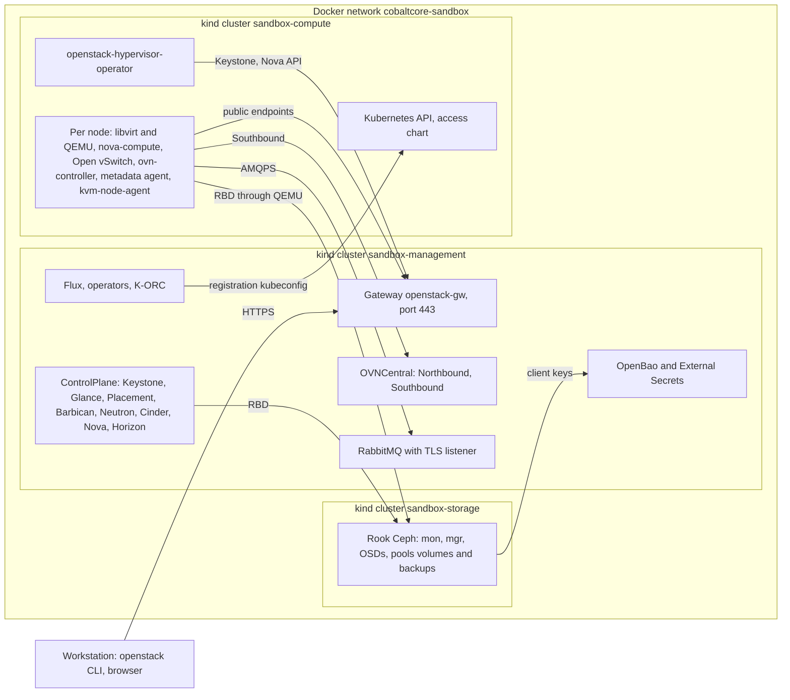

# CobaltCore OpenStack Sandbox

A modular sandbox for evaluating the parts of
[CobaltCore OpenStack](https://github.com/C5C3/cobaltcore) on a single Linux
host. It rebuilds the lab of the upstream
[Quick Start (metal-stack)](https://c5c3.github.io/cobaltcore/quick-start-metal-stack.html) on
[kind](https://kind.sigs.k8s.io/) clusters instead of a Gardener shoot, and
splits it across three clusters: one for management and control plane, one for
storage, one for compute.

The idea for this sandbox and its implementation come out of the
[IPCEI-CIS Hackathon Potsdam](https://apeirora.eu/content/news/apeirora-ipcei-cis-hackathon/)
of the IPCEI-CIS and NeoNephos community, November 24 to 26, 2026.

> **Status: specification.** Nothing in this repository is implemented yet.
> This README describes what is to be built, which upstream material it builds
> on, and which points have to be proven first. It was written against
> `C5C3/cobaltcore` at `15a0323e` and `C5C3/playground` at `d2e6b596`
> (both 2026-11-24). Statements marked *upstream* are taken from those
> sources. Everything else is the design of this sandbox and is unverified
> until the milestone that builds it has run.

## Contents

- [Goals](#goals)
- [Non-goals](#non-goals)
- [What upstream provides](#what-upstream-provides)
- [Target topology](#target-topology)
- [Cluster roles](#cluster-roles)
- [Networking and addresses](#networking-and-addresses)
- [Interfaces between the clusters](#interfaces-between-the-clusters)
- [Deployment model](#deployment-model)
- [Modules](#modules)
- [Profiles](#profiles)
- [Orders](#orders)
- [External storage and external compute](#external-storage-and-external-compute)
- [Repository layout](#repository-layout)
- [Planned command surface](#planned-command-surface)
- [Host requirements](#host-requirements)
- [Footprint](#footprint)
- [Milestones](#milestones)
- [Points to prove first](#points-to-prove-first)
- [Design decisions](#design-decisions)
- [References](#references)

## Goals

1. **The metal-stack quick start on kind.** One `ControlPlane` resource runs
   Keystone, Glance, Placement, Barbican, Neutron on OVN, Cinder on Ceph, Nova
   and Horizon. KVM hypervisors boot servers, attach RBD volumes, live-migrate,
   get evicted, and volumes are backed up, restored and survive a key rotation.
   The acceptance test of the full build is Part 1 and Part 2 of that quick
   start, run against the sandbox.
2. **Dedicated clusters per role.** Management and control plane share one
   kind cluster. Storage (Ceph) and compute (hypervisors) each get a kind
   cluster of their own and attach to the control plane over the interfaces a
   real site would use.
3. **Modular.** Every part is a module that can be enabled, left out or
   replaced, so a single part can be evaluated without the rest: only the
   identity service, the control plane without compute, Cinder on Ceph without
   hypervisors, and so on.
4. **Single replicas.** No high availability in the first build: one pod per
   component, the `Minimal` sizing profile, one Ceph monitor.
5. **Orders.** The order mechanism of the
   [Quick Start (Orders)](https://c5c3.github.io/cobaltcore/quick-start-orders.html) is usable: a service
   owner orders Keystone, MariaDB and RabbitMQ pieces from an assigned
   namespace on the management cluster.
6. **External storage and external compute, later.** Once the initial build
   stands, a Ceph cluster and a compute cluster that the sandbox does not
   create can be registered in place of, or beside, the kind ones. The
   initial build must not block this: the clusters talk to each other only
   through addresses and credentials that an external cluster can use too.
7. **A 16 GiB host where possible.** The profiles up to `full` aim at a host
   with 16 GiB of memory. Everything that costs memory and is not needed for
   the part under evaluation is a switch. See [Footprint](#footprint).

## Non-goals

- High availability, production sizing, or a hardened security posture. The
  sandbox runs privileged pods, a private CA and lab credentials.
- Surviving a host reboot or a Docker restart. kind does not keep node
  addresses stable, and Ceph monitors and the registration kubeconfigs depend
  on them. The sandbox is rebuilt, not repaired.
- macOS and Windows hosts. The design relies on the host and all clusters
  sharing one routable Docker network and on `/dev/kvm`.
- Gardener and metal-stack specifics of the upstream lab: the `shoot-info`
  ConfigMap, Lightbits volumes, the public internet address.
- A dedicated network cluster. OVN chassis run on the compute nodes, as in
  the upstream lab. Gateway nodes and a BGP fabric can become a module later.
- Glance on RBD and Nova ephemeral disks on RBD. *Upstream* supports Ceph for
  Cinder volumes and backups only; Glance stays on the Garage S3 store and
  instance disks on `qcow2`.
- Orders on a target cluster, Part 2 of the upstream orders quick start.
  Owners' namespaces live on the management cluster.
- Continuous image automation, load tests, chaos tests and Tempest runs as the
  playground operates them. They can be added as modules once the build
  stands.

## What upstream provides

The sandbox composes upstream material and adds only what kind and the split
across clusters need.

| Source | What the sandbox takes from it |
| --- | --- |
| [Quick Start (ControlPlane)](https://c5c3.github.io/cobaltcore/quick-start-controlplane.html) | The `ControlPlane` and `OVNCentral` resources, the `Minimal` sizing, the database tenant onboarding, the verification steps. It runs everything on one kind cluster behind `*.127-0-0-1.nip.io:8443` |
| [Quick Start (metal-stack)](https://c5c3.github.io/cobaltcore/quick-start-metal-stack.html) | The lab to rebuild: public Gateway on port 443 with a lab CA, Rook Ceph with the pools `volumes` and `backups`, Cinder RBD backend and backup target, libvirt DaemonSet, `OVNChassis`, `NeutronMetadataAgent`, `NovaCompute`, openstack-hypervisor-operator (hvo) and kvm-node-agent (kna). It runs everything in one cluster |
| [Quick Start (Orders)](https://c5c3.github.io/cobaltcore/quick-start-orders.html) | The seven order kinds and the namespace assignment of its Part 1. Its Part 2, orders on a second cluster, is not built |
| [Connect a Compute Cluster](https://c5c3.github.io/cobaltcore/guides/nova/connect-a-compute-cluster.html) | The contract for hypervisors on another cluster than the control plane: what the ControlPlane delivers, what the compute cluster has to provide |
| [Target Clusters](https://c5c3.github.io/cobaltcore/reference/target-clusters.html) and [Deploy to a Target Cluster](https://c5c3.github.io/cobaltcore/guides/deploy-to-a-target-cluster.html) | The `target-cluster-access` chart, the registration Secret, `spec.targetClusterRef` |
| `deploy/bases` and `deploy/overlays` of `C5C3/cobaltcore` | The reusable Flux stages (`operators`, `tls`, `shared-openbao`, `eso-store`, `controlplane-operator`), the development sizing in `bases/devstack`, and the lab manifests under `overlays/metal-stack` |
| [C5C3/playground](https://github.com/C5C3/playground) | The repository shape: Flux stages per cluster under `clusters/`, upstream included at `vendor/cobaltcore`, bootstrap steps as Jobs, a validation script, decisions recorded as ADRs |

Four facts from upstream shape the design:

- **The split across clusters is documented but not tested upstream.** The
  architecture describes storage and compute clusters attached to a control
  plane. The dedicated storage cluster is a
  [sketch](https://c5c3.github.io/cobaltcore/future/storage-cluster.html), and for compute upstream states
  that no suite crosses a cluster boundary with Nova, exposes a broker, or
  runs hvo. The sandbox would be the first environment that exercises these
  paths end to end.
- **Ceph on kind is open upstream.** `WITH_CEPH=true` has no kind overlay and
  the kind mode of `make deploy-infra` refuses it
  ([cobaltcore#1339](https://github.com/C5C3/cobaltcore/issues/1339)). The
  issue names the OSD as the hard part: kind nodes have no spare block device
  and the local-path provisioner has no block mode.
- **A compute cluster needs a brownfield message bus with TLS.** The
  ControlPlane webhook admits `spec.services.nova.remoteCompute` only with
  `spec.infrastructure.messaging.secretRef` and `.tls`. The managed
  `RabbitmqCluster` has no TLS listener. The messaging mode cannot be changed
  after the ControlPlane exists.
- **A brownfield bus serves no `RabbitMQVhost` orders.** They report
  `MessagingNotManaged`. With a compute cluster attached, six of the seven
  order kinds work. See [Profiles](#profiles) and [Orders](#orders).

## Target topology



Flux runs on the management cluster only and applies the stages of the other
two clusters through their kubeconfigs.

## Cluster roles

### sandbox-management

Management and control plane in one cluster, which is the topology upstream
implements today.

- Flux, cert-manager, External Secrets Operator, Envoy Gateway, the shared
  OpenBao (one replica), K-ORC. Flux is the hub for all three clusters, as in
  upstream's sketch of the management cluster.
- The infrastructure operators (MariaDB, Memcached, RabbitMQ cluster and
  topology, OpenBao, Garage), the service operators of the enabled services
  and the c5c3-operator.
- One `ControlPlane` named `controlplane` and one `OVNCentral` named
  `controlplane-ovn` in the namespace `openstack`, with the names the
  upstream guides use, so their commands run unchanged.
- The backing services the ControlPlane provisions: MariaDB, Memcached, the
  dedicated OpenBao of Barbican. Garage holds the Glance images.
- The message bus. On the path to `full` it is a `RabbitmqCluster` the
  sandbox owns, with a TLS listener published to the compute cluster.
- The kubeconfig Secrets of the other clusters: the registration Secret in
  `c5c3-clusters` that the CobaltCore operators use, and the ones Flux deploys
  with.
- The `OVNChassis`, `NeutronMetadataAgent` and `NovaCompute` resources that
  name the compute cluster in `targetClusterRef`.
- The namespaces of service owners and their orders.

One node. Kind strips the control-plane taint from a single-node cluster.

### sandbox-storage

The cluster upstream labels Ceph Storage.

- Rook operator and one `CephCluster`: one monitor, one manager and, by
  default, one OSD. Three OSDs are a switch.
- The RBD pools `volumes` and `backups`, with one replica on one OSD and two
  replicas on failure domain `osd` with three. *Upstream* rule: CobaltCore
  uses pools and never creates them, so the storage cluster owns them.
- The `CephClient` users `cinder` and `cinder-backup`, one cephx user per
  consumer.
- The key hand-off: a `PushSecret` per client writes its key into the OpenBao
  of the management cluster, from where the consumers read it.
- The Ceph toolbox for the checks of the quick start (`ceph status`,
  `rbd info`).

One node. The OSDs sit on loop devices that the sandbox creates in the node
and offers to Rook as static local volumes with `volumeMode: Block`, so the
upstream `storageClassDeviceSets` shape stays. This is the first point to
prove, see [Points to prove first](#points-to-prove-first).

### sandbox-compute

The cluster upstream labels OpenStack Compute.

- One worker node as KVM hypervisor and OVN chassis by default. The `parity`
  profile runs two, the minimum for the tunnel check, the live migration and
  the eviction of the quick start.
- The `target-cluster-access` chart, which gives the CobaltCore operators of
  the management cluster their identity here.
- Created by those operators through `targetClusterRef`: the Open vSwitch and
  `ovn-controller` pods of the `OVNChassis`, the metadata agent, the
  `nova-compute` pods of the `NovaCompute` pool.
- Installed by the sandbox in the role of the cluster's owner, to whom
  upstream leaves them: the libvirt DaemonSet, hvo, kna, cert-manager with the
  CA for libvirt's migration TLS, the reservation of the migration ports, and
  the External Secrets Operator that fetches the `cinder` key for libvirt.
- `virtType: kvm` where the host offers `/dev/kvm`, which kind nodes see
  because they run privileged. `virtType: qemu` (TCG) is the fallback, as in
  the upstream suite `e2e-nova-libvirt`.

All kind nodes share the host kernel. Each node has its own network
namespace, so each runs its own Open vSwitch datapath and its own reservation
of the migration ports.

## Networking and addresses

All clusters join one user-defined Docker network. The host reaches every
address on it directly, which is why a Linux host is required.

| Item | Design |
| --- | --- |
| Docker network | `cobaltcore-sandbox` with a fixed, configurable subnet (default proposal `172.30.0.0/16`), selected through `KIND_EXPERIMENTAL_DOCKER_NETWORK`. A network of its own keeps the address plan apart from other kind clusters on the host |
| Load balancer | MetalLB in layer-2 mode on the management cluster, with a pool from the upper end of the subnet. Services ask for a fixed address, so every published address is known before the first deploy |
| Gateway | The Envoy proxy of `openstack-gw` as a `LoadBalancer` Service on port 443, as in the upstream lab. With the address `172.30.255.10` the suffix is `172-30-255-10.nip.io` and the endpoints are `https://keystone.<suffix>/v3`, `https://horizon.<suffix>`, `https://nova-console.<suffix>`, `https://nova-metadata.<suffix>` and one per remaining service |
| Names | [nip.io](https://nip.io) resolves `<name>.<a-b-c-d>.nip.io` to the address, for the workstation and for the pods of every cluster alike. No CoreDNS rewrite and no `/etc/hosts` entry is needed |
| Certificates | One sandbox CA from cert-manager, name-constrained to `nip.io` like the upstream lab CA. It signs the Gateway certificate `*.<suffix>` and the certificate of the broker's TLS listener. `sandbox-ca.pem` is what the workstation passes as `OS_CACERT` |
| Message bus | AMQPS on a load-balancer address of its own, `rabbitmq.<a-b-c-d>.nip.io:5671` |
| OpenBao | Port 8200 with mutual TLS on a load-balancer address, for the External Secrets Operators of the storage and compute clusters |
| OVN | `externallyReachable: true` on both databases of the `OVNCentral`. The ovn-operator publishes them on node ports of the management node |
| Ceph | Rook with host networking on the storage cluster, so monitors (3300) and OSDs (6800 to 7300) answer on the node's address on the Docker network. Clients name the monitor by the node's container name, which Docker's DNS resolves. The `networks` field of the RBD backends carries the Docker subnet |
| Kubernetes APIs | `https://<cluster>-control-plane:6443`, the address of `kind get kubeconfig --internal`, used in the registration kubeconfig and in the kubeconfigs of Flux |
| MTU | The Docker bridge carries 1500, so `global_physnet_mtu` is `1500` and tenant networks get 1442, where the upstream lab has 1460 and 1402 |

Nothing binds a port on a host interface. The sandbox is reachable from the
host only; a remote workstation uses an SSH tunnel or a route to the Docker
subnet.

Every address above comes from one configuration file and reaches the
manifests through Flux `postBuild` substitution from a `cluster-vars`
ConfigMap, as on the playground. No manifest carries a literal address.

## Interfaces between the clusters

These are the only paths between the clusters. An external storage or compute
cluster uses the same ones, see
[External storage and external compute](#external-storage-and-external-compute).

| # | From | To | Purpose | Carried by |
| --- | --- | --- | --- | --- |
| 1 | Flux on management | Kubernetes APIs of storage and compute | Apply the stages and Helm releases of those clusters | Kubeconfig Secrets the sandbox creates with the clusters |
| 2 | CobaltCore operators on management | Kubernetes API of compute | Create the projected workloads and deliver Secrets | Registration Secret in `c5c3-clusters` with the kubeconfig of the access chart's ServiceAccount |
| 3 | `nova-compute`, hvo on compute | Gateway, port 443 | Keystone and the public catalog rows of Placement, Neutron, Glance, Cinder, Barbican | The remote compute contract |
| 4 | `nova-compute` on compute | Broker, AMQPS | RPC | `transport_url` and `ca.crt` of the remote compute contract |
| 5 | `ovn-controller`, metadata agent on compute | Southbound node ports on management | Chassis registration, port lookups | Client certificate the ovn-operator copies as `<chassis>-ovn-client` |
| 6 | Metadata agent on compute | `nova-metadata.<suffix>`, port 443 | Instance metadata | Shared secret the ControlPlane copies, CA bundle the sandbox places |
| 7 | Console proxy on management | VNC on the compute nodes' addresses | noVNC consoles | Node addresses on the Docker network |
| 8 | `cinder-volume`, `cinder-backup` on management | Ceph monitors and OSDs on storage | Volumes and backups | Monitor address, pool, user and key Secret in the `CinderBackend` entry |
| 9 | QEMU on compute | Ceph monitors and OSDs on storage | Attached RBD volumes | libvirt secret defined from the `cinder` key |
| 10 | External Secrets on storage | OpenBao on management | Push the client keys | Client certificate for OpenBao's mutual TLS, auth mount `kubernetes/storage`, policy `push-ceph-keys` |
| 11 | External Secrets on compute | OpenBao on management | Read the `cinder` key for libvirt | Client certificate for OpenBao's mutual TLS, auth mount `kubernetes/hypervisor`, a sandbox policy that reads `ceph/client-cinder` |
| 12 | OpenBao on management | Kubernetes APIs of storage and compute | Token review for 10 and 11 | `auth/kubernetes/<cluster>/config`, which the upstream bootstrap leaves for the time those clusters exist |
| 13 | Compute node | Compute node | Geneve (UDP 6081), libvirt TLS (16514), QEMU migration (49152 to 49215); with two nodes only | Docker network |
| 14 | Workstation | Gateway, port 443 | CLI, Horizon, noVNC | `sandbox-ca.pem` |

Path 1 exists because the sandbox owns all three clusters. An external
cluster is deployed by its owner, and the paths 2 to 13 are what it shares
with the sandbox.

*Upstream* delivers three Secrets to a compute cluster by itself:
`controlplane-nova-compute-config` (the mirror of the remote contract),
`controlplane-nova-hypervisor-operator-auth` and
`controlplane-nova-metadata-agent-secret`. Everything else in the table is
set up by sandbox modules.

## Deployment model

The sandbox is a deployment repository in the sense of upstream's
`deploy/README.md`: upstream ships bases and leaves the source, the Flux
stages, the environment patches and the bootstrap execution to the repository
that deploys them.

- **Flux on the management cluster, as hub.** The management cluster runs the
  flux-operator and a `FluxInstance` and reconciles `clusters/<cluster>/` for
  all three clusters. A stage is a Flux `Kustomization` with `dependsOn`,
  `wait` and health checks, as on the playground. Stages of the storage and
  compute clusters name a kubeconfig Secret in `spec.kubeConfig`, and Helm
  releases for those clusters are `HelmRelease` objects on the management
  cluster with the same field. Two clusters run without Flux controllers,
  which saves memory, and the hvo release reads its values straight from the
  Secret the ControlPlane writes on the management cluster.
- **Source from the working tree.** A small registry container on the Docker
  network holds the repository as an OCI artifact. `make push` packages the
  working tree and pushes it, and Flux follows the tag. Changes are tested
  without a commit or a push to GitHub, and a fork works without access to a
  Git remote. The same registry can serve as a pull-through cache for the
  images.
- **Upstream by inclusion, pinned, moved on a schedule.** `make vendor` checks
  out `C5C3/cobaltcore` at the commit recorded in the configuration into
  `vendor/cobaltcore`, which Git ignores and which becomes part of the
  artifact. Stages reference `vendor/cobaltcore/deploy/...` and patch what
  differs. A scheduled workflow moves the pin to upstream `main`, runs
  `make validate` and opens a pull request, and a passing validation is the
  gate for merging it. The validation renders every stage against the new
  checkout, checks the result against the schemas, and checks that every
  patch still finds its target. It cannot see a break that only shows at run
  time, so `make up` records the pin it ran with, and holding the pin is one
  line.
- **Bootstrap steps as Jobs.** OpenBao initialisation and unseal, the auth
  mounts and policies, and the database tenant onboarding
  (`setup-database-tenant.sh`) run as Jobs that mount the upstream scripts,
  the way the playground runs them. No step is typed by hand after `make up`.
- **A thin command layer.** A Makefile and a few scripts do what Flux cannot:
  create the Docker network, the registry and the kind clusters, prepare the
  nodes (loop devices, labels), install Flux, exchange what crosses a cluster
  boundary before Flux can (kubeconfigs, the token-review configuration of
  OpenBao, CA bundles), and print access data.

## Modules

A module is one directory with a kustomization and one Flux `Kustomization`
that names its dependencies. A cluster enables a module by listing it. The
modules of the storage and compute clusters are applied from the management
cluster. The table is the planned set; M marks the milestone that builds it.

### On sandbox-management

| Module | Content | Depends on | M |
| --- | --- | --- | --- |
| `crds` | Gateway API and Envoy Gateway CRDs | | 1 |
| `controllers` | The upstream base `operators` (cert-manager, External Secrets, the infrastructure operators, the service operators, K-ORC) and Envoy Gateway. The releases of service operators whose service is not enabled stay suspended | `crds` | 1 |
| `loadbalancer` | MetalLB and its address pool | `controllers` | 1 |
| `pki` | Sandbox CA, ClusterIssuers, the upstream `tls` base | `controllers` | 1 |
| `gateway` | GatewayClass, Gateway `openstack-gw`, wildcard certificate | `loadbalancer`, `pki` | 1 |
| `openbao` | Shared OpenBao with one replica, bootstrap Job, ESO store | `pki` | 1 |
| `objectstore` | Garage and the bucket `glance-images` | `controllers` | 1 |
| `platform` | The c5c3-operator (upstream base `controlplane-operator`) | `controllers`, `openbao` | 1 |
| `messaging-tls` | The sandbox's `RabbitmqCluster` with a TLS listener, its certificate, the transport URL Secrets | `pki`, `loadbalancer` | 1 |
| `sizing` | The `SizingProfile` `sandbox` on base `Minimal`, which carries the reductions the measurements allow | `platform` | 1 |
| `controlplane` | `OVNCentral`, `ControlPlane`, database tenant onboarding Job. Composed from one component per service, see [Profiles](#profiles) | `platform`, `gateway`, `sizing` | 1 |
| `fake-compute` | The upstream fake compute, for a control plane without hypervisors | `controlplane` | 1 |
| `orders` | Owners' namespaces, the namespace assignment and the example orders | `controlplane` | 2 |
| `openbao-remote-auth` | Auth mounts, roles and policies for the storage and compute clusters, OpenBao on a load-balancer address | `openbao` | 3 |
| `ceph-keys` | ExternalSecrets `ceph-client-cinder` and `ceph-client-cinder-backup` in `openstack` | `openbao-remote-auth` | 3 |
| `cinder-rbd` | The `cinder` block of the ControlPlane with the backend `ceph1`. The backup target `cephbk` is a switch | `ceph-keys`, `controlplane` | 3 |
| `remote-compute` | `remoteCompute`, `hypervisorOperator`, `metadataGateway`, `consoleProxy` on the ControlPlane, `externallyReachable` on the OVN central | `controlplane`, `messaging-tls` | 4 |
| `hypervisor-fixtures` | The K-ORC fixtures hvo needs: domain `cc3test`, project `test`, flavor `1`, image `cirros-kvm` | `remote-compute` | 4 |
| `compute-pool` | `OVNChassis`, `NeutronMetadataAgent` with reduced memory, `NovaCompute`, each with `targetClusterRef` | `remote-compute`, registration of the compute cluster | 4 |
| `observability`, `ui` | Prometheus and Grafana; Headlamp and Flux Web. Off by default | `controllers` | later |

### On sandbox-storage

| Module | Content | Depends on | M |
| --- | --- | --- | --- |
| `controllers` | External Secrets; cert-manager only if the key hand-off needs it there | | 3 |
| `block-devices` | StorageClass and static local volumes over the loop devices | node preparation | 3 |
| `rook-operator` | The upstream `ceph` overlay: Rook chart, namespace, the `ClientProfile` CRD | | 3 |
| `ceph-cluster` | `CephCluster`, pools, clients, toolbox, patched for one host, host networking and the sandbox's sizes | `rook-operator`, `block-devices` | 3 |
| `key-push` | SecretStore against the management OpenBao and the two PushSecrets | `ceph-cluster`, `openbao-remote-auth` on management | 3 |

### On sandbox-compute

| Module | Content | Depends on | M |
| --- | --- | --- | --- |
| `access` | The `target-cluster-access` chart with `namespaces={openstack}`, `privilegedNamespaces={openstack}`, `createNamespaces=true` | | 4 |
| `controllers` | cert-manager, External Secrets | | 4 |
| `node-prep` | Node labels and the `aggregates` annotation, the migration port reservation, the namespace `hypervisor-system` | | 4 |
| `trust` | The sandbox CA where the metadata agent, `nova-compute` and hvo read it | `access` | 4 |
| `libvirt` | The libvirt CA and Issuer, the libvirt DaemonSet and its ConfigMap, adapted to kind | `controllers`, `node-prep` | 4 |
| `kvm-node-agent` | The kna release | `libvirt` | 4 |
| `hypervisor-operator` | The hvo release, with its values from the auth Secret on the management cluster | `access`, `compute-pool` on management | 4 |
| `ceph-libvirt-secret` | ExternalSecret for the `cinder` key that the `ceph-secret` container of libvirt reads | `openbao-remote-auth` on management | 5 |

## Profiles

A profile is a named selection of clusters, modules and switches. It is a
convenience on top of the module lists, not a second mechanism.

| Profile | Clusters | What runs | Evaluates |
| --- | --- | --- | --- |
| `identity` | management | Keystone | The operator model, OpenBao and ESO, K-ORC, credential rotation, orders |
| `controlplane` | management | All eight services, fake compute, managed message bus | Parity with the Quick Start (ControlPlane); all seven order kinds |
| `storage` | management, storage | Keystone, Cinder with the volume backend on Ceph | RBD backend, key hand-off and rotation, without hypervisors |
| `full` | management, storage, compute | Keystone, Glance, Placement, Neutron, Nova, Cinder on Ceph, one hypervisor node, TLS message bus | Servers on KVM with RBD volumes across three clusters |
| `parity` | management, storage, compute | `full` plus Barbican, Horizon, `cinder-backup`, a second hypervisor node, three OSDs | Parity with the Quick Start (metal-stack), the acceptance test of goal 1 |

`identity`, `controlplane`, `storage` and `full` aim at a 16 GiB host.
`parity` is not expected to fit one, see [Footprint](#footprint).

The ControlPlane is composed from kustomize components, one per
`spec.services` block. *Upstream* makes every block optional, so leaving a
component out leaves the service out. Which services a block requires beside
it is checked at admission; *upstream* names Placement, Neutron and Glance
for Nova. The switches on top of the profiles:

| Switch | Adds | Default |
| --- | --- | --- |
| `horizon`, `barbican`, `glance` | The service and its operator | per profile |
| `cinder-backup` | The backup target `cephbk` and the `cinder-backup` Deployment | on in `parity` |
| `hypervisor-nodes` | Worker nodes of the compute cluster | 1; 2 in `parity` |
| `osd-count`, `osd-size` | OSDs of the storage cluster and the size of their sparse files | 1 OSD; 3 in `parity` |
| `fake-compute` | A compute without a hypervisor | on in `controlplane` |
| `observability`, `ui` | Prometheus and Grafana; Headlamp and Flux Web | off |

Three settings are fixed when the ControlPlane is created, so a profile
chooses them up front and a change means recreating the ControlPlane:

- The **messaging mode**. A compute cluster needs the brownfield TLS bus, so
  `storage`, `full` and `parity` use it, and `identity` can be started with
  it to grow into them without a rebuild. `messaging-tls` is therefore part
  of milestone 1. `controlplane` keeps the managed bus and is the place to
  evaluate `RabbitMQVhost` orders.
- Every `targetClusterRef`.
- `database.replicas` and `database.storageSize`.

Everything else is additive on a running sandbox: a further service, the
storage cluster, the compute cluster, a switch.

## Orders

Orders run from assigned namespaces on the management cluster, as in Part 1
of the upstream quick start.

- The module `orders` creates the owner's namespace, adds the
  `namespaceAssignments` entry to the ControlPlane and applies the example
  orders: `KeystoneUser`, `KeystoneProject`, `KeystoneRoleAssignment`,
  `KeystoneCatalogEntry`, `KeystoneApplicationCredential`,
  `MariaDBDatabase` and `RabbitMQVhost`.
- On the managed bus of the `controlplane` profile all seven kinds converge.
  On the TLS bus of the other profiles `RabbitMQVhost` reports
  `MessagingNotManaged` and the other six converge. Six of seven beside a
  compute cluster is accepted (D10).
- Further owners are further namespaces with an assignment each.
- The verification is the one of the upstream page: the credentials Secret
  sits beside each order, the credential rotates, and the teardown removes
  what the orders created.

## External storage and external compute

Built after the initial build stands. The module boundaries above are drawn
so that this is a matter of configuration and not of restructuring.

**External storage.** A Ceph cluster the sandbox does not create replaces or
joins `sandbox-storage`:

- Its owner provides monitor addresses, the pools, one cephx user per
  consumer and the keys. *Upstream* requires that this always works by hand
  (`ceph auth get-or-create` and `kubectl create secret`); pushing the keys
  into the sandbox's OpenBao is the automated variant.
- The sandbox adds a `CinderBackend` entry (and optionally the backup target)
  with those values. Several backends run side by side, each with a
  `cinder-volume` Deployment of its own, so `ceph1` on kind and `ceph2`
  external can be compared in one control plane.

**External compute.** A Kubernetes cluster with KVM nodes that the sandbox
does not create replaces or joins `sandbox-compute`:

- Its owner installs the access chart, libvirt with its migration PKI, hvo and
  kna, and labels the nodes. The sandbox registers the cluster and applies a
  chassis, a metadata agent and a pool with names of their own. This is the
  upstream guide Connect a Compute Cluster, steps 4 to 7 per cluster.

**Reach through a VPN.** External clusters join over a VPN that routes
between the sandbox's Docker subnet and the external networks (D12):

- The published addresses and their nip.io names stay as they are. External
  nodes reach the Gateway, the broker, the Southbound node ports, OpenBao and
  the kind Ceph on the same addresses the kind clusters use, so the address
  plan needs no second mode.
- In the other direction the management cluster reaches the external API
  server and the VNC ports of external hypervisors, and Cinder reaches an
  external Ceph.
- The Docker subnet must not overlap a network of the external site, which is
  one reason it is configurable. Resolvers on the external site have to
  return the private addresses behind the nip.io names.
- The VPN software and where its endpoint runs are settled in milestone 7.

What this asks of the initial build:

- Published addresses and the Docker subnet are configuration.
- Registration is a module of its own with inputs (kubeconfig, names), not a
  side effect of creating a kind cluster.
- The compute and storage modules on the management cluster take the cluster
  they attach to as a parameter, so a second instance of each is a second
  entry.

## Repository layout

Proposed, following the playground:

```text
clusters/
  management/        Flux entry point: sources, stages, cluster-vars
  storage/           Stages the management cluster applies to sandbox-storage
  compute/           Stages the management cluster applies to sandbox-compute
infrastructure/      Stages every cluster may use: crds, controllers,
                     loadbalancer, pki, gateway, openbao, objectstore, ...
platform/            The c5c3-operator and the sizing profile
controlplane/        OVNCentral, ControlPlane base and one component per service
storage/             rook-operator, ceph-cluster, block-devices, key-push
compute/             access, node-prep, libvirt, hypervisor-operator, ...
orders/              Owners' namespaces, assignment and example orders
profiles/            One file per profile: clusters, modules, switches
kind/                kind cluster configurations
scripts/             Cluster lifecycle, node preparation, registration, validation
docs/adr/            Design decisions, one file each
.github/workflows/   Validation and the scheduled move of the upstream pin
config.yaml          Addresses, sizes, the upstream pin
Makefile
vendor/              Upstream checkout, ignored by Git
```

## Planned command surface

```bash
make up PROFILE=full        # network, registry, clusters, Flux, wait until ready
make up-management          # one cluster at a time
make up-storage
make up-compute
make push                   # publish the working tree to Flux
make status                 # Flux stages and the conditions that matter, per cluster
make footprint              # memory requests and working set, per cluster and in total
make env                    # print OS_* variables, write sandbox-ca.pem
make verify                 # the checks of the milestones the profile covers
make vendor                 # refresh vendor/cobaltcore at the pinned commit
make validate               # render every stage and check it against the schemas
make down                   # delete clusters, registry, network, loop devices
```

`make verify` is the quick start turned into a script: each milestone below
lists the checks it adds.

## Host requirements

| Requirement | Detail |
| --- | --- |
| Operating system | Linux on x86-64 with cgroup v2 and rootful Docker |
| Virtualization | `/dev/kvm`. On a virtual machine this needs nested virtualization; without it the compute pool falls back to `virtType: qemu` |
| Kernel modules | `openvswitch`, `geneve`, `vhost_net`, `loop`; `nfs` and `nfsv4` only for the optional NFS backend. kind nodes use the host's module tree |
| Kernel settings | `fs.inotify.max_user_instances` at 512 or more. *Upstream*: a second kind cluster beside a full devstack fails at `Preparing nodes` with the default of 128 |
| Memory | 16 GiB as the target for the profiles up to `full`; more for `parity`. See [Footprint](#footprint) |
| CPU | To be measured. *Upstream* budgets 4 vCPU for the control plane with all eight services. Working estimate for `full`: 8 cores |
| Disk | To be measured. Every kind node keeps its own image store, so an image is stored once per node that runs it. Working estimate: 60 GB free for `full`, 100 GB for `parity`, including the sparse OSD files |
| DNS | The resolver must answer `*.nip.io` names with private addresses. Resolvers with DNS rebinding protection drop such answers; a module with a CoreDNS template and a local resolver entry is the fallback |
| Tools | `docker`, `kind`, `kubectl`, `helm`, `flux`, `yq` v4.40.1 or newer, `jq`, `make`, and the OpenStack CLI with `osc-placement` and `python-barbicanclient` |
| Network | Egress to `ghcr.io`, `quay.io`, `docker.io`, the Helm repositories and the cirros download |

## Footprint

The target is a host with 16 GiB of memory for the profiles up to `full`.
It is a target and not a result: the upstream figures say it is tight, and
only measurements on the sandbox settle it.

What upstream measured, as memory requests on the `Minimal` profile
([Sizing Calibration](https://c5c3.github.io/cobaltcore/reference/testing/sizing-calibration.html)):

| Part | Requests | Note |
| --- | --- | --- |
| One kind node with the control plane of all eight services, Cinder on NFS, the backing services, every operator and Kubernetes | 14,754 MiB | The total of upstream's CI node, checked against a gate of 4 vCPU and 16 GiB |
| of which the OpenStack services with MariaDB and Memcached | 9,488 MiB | The rest, about 5.1 GiB, is operators, Flux, OpenBao, Garage, the Gateway, a broker at 512 MiB and Kubernetes |
| `cinder-backup` | 2,048 MiB | The largest single container |
| Glance; Horizon; Barbican with its OpenBao | 1,040; 720; 432 MiB | At the figures the profile carries now |
| RabbitMQ | 1,024 MiB | Cannot go lower: at 512 MiB an idle broker raises its memory alarm |
| Metadata agent per hypervisor node | 2,048 MiB | The default covers 32 networks. The lab read a working set of 550 MiB with one network, and 768 MiB is the floor of upstream's formula |
| `nova-compute` per hypervisor node | 768 MiB | |
| Lab Ceph | 1 GiB monitor, 512 MiB manager, 2 GiB per OSD | Nine OSDs on the lab |

By these figures the control plane of the `controlplane` profile alone fills
a 16 GiB host, which is the case upstream gates. Adding two clusters to it
does not fit. The sandbox therefore reduces:

- **Services by profile.** `full` leaves out `cinder-backup`, Horizon and
  Barbican, which removes about 3.1 GiB of requests, and the operators of
  services that are off stay suspended.
- **One hypervisor node** with the metadata agent at 768 MiB, and guests of
  flavor `1` with 256 MiB.
- **One OSD** of about 1 GiB with single-replica pools, and reduced requests
  for monitor and manager.
- **One Flux**, on the management cluster.
- **No observability and no UIs** by default.
- **A sizing profile of its own**, `sandbox` on base `Minimal`, which lowers
  a request wherever a measurement on the sandbox shows room.

Summed as requests, `full` then stands at roughly:

| Cluster | Content | Requests |
| --- | --- | --- |
| management | Platform about 4.6 GiB, the six services with MariaDB, Memcached and RabbitMQ about 7.8 GiB | 12.4 GiB |
| storage | Kubernetes, Rook, monitor, manager, one OSD | about 3 GiB, estimate |
| compute | Kubernetes, `nova-compute`, metadata agent, libvirt, Open vSwitch, two guests | about 3 GiB, estimate |
| | | about 18 GiB |

That is above 16 GiB. Requests are not use: upstream derives them from VPA
recommendations, which lie above what the pods were seen to use, and kind
schedules each cluster on its own, so the sum of requests blocks nothing.
What decides is the working set of all three clusters together, which nobody
has measured. `make footprint` reports it, every milestone records it, and
milestone 1 gives the first hard number for the largest part. If `full` does
not fit, the next steps are lower requests in the sizing profile, further
switches and, failing that, a documented requirement above 16 GiB.

`parity` adds back what was left out and a second hypervisor node. Working
estimate: 24 to 32 GiB.

## Milestones

Each milestone ends with checks taken from the upstream quick starts, so
"done" means the corresponding upstream steps pass on the sandbox. Every
milestone also records the output of `make footprint`.

| M | Result | Done when |
| --- | --- | --- |
| 0 | Scaffold: configuration, Docker network, registry, three kind clusters, Flux on the management cluster applying to all three from the working tree, `make validate` in CI, the scheduled pin workflow, ADRs for the decisions below | `make up` creates the clusters, the `FluxInstance` is Ready and a test stage reaches each cluster; `make down` leaves nothing behind |
| 1 | Control plane on `sandbox-management` behind the Gateway on port 443, with the sandbox CA and the TLS bus; profiles `identity` and `controlplane` | Quick Start (ControlPlane) Step 7 on `controlplane`: token, catalog, image upload, placement, secret, network, server on the fake compute, Horizon login. No `--insecure` |
| 2 | Orders from namespaces on the management cluster | Quick Start (Orders) Part 1: seven kinds on `controlplane`, six on the TLS bus |
| 3 | Ceph on `sandbox-storage`, key hand-off through OpenBao, Cinder on RBD; profile `storage` | `cinder-volume` on `controlplane-cinder@ceph1` is `up`, a volume is created and its image shows in `rbd info`. With `cinder-backup` on: backup, restore, and the `cinder-backup` key rotates |
| 4 | One hypervisor on `sandbox-compute` | Quick Start (metal-stack) Part 2 Steps 1 to 5 on one node, and of Step 6 the metadata call and the noVNC console: `Hypervisor` onboarded, pool `Ready`, a server `ACTIVE` |
| 5 | Volumes on the hypervisor; profile `full` | Part 2 Step 7: attach, marker written and read back. The `cinder` key rotates and the server reads the volume again after a hard reboot |
| 6 | Profile `parity`, on a host with the memory it needs | Quick Start (metal-stack) Part 1 and Part 2 complete: tunnel ping between two nodes, live migration, eviction, backup and restore, rotation under a running server, Horizon |
| 7 | External storage and external compute over a VPN | A second RBD backend on an external Ceph serves volumes; a pool on an external cluster boots a server |
| later | NFS backend (Part 3), observability, UIs, Tempest, chaos, an HA profile, a network cluster | |

Milestones 2 and 3 do not depend on each other and can be built in either
order. Milestone 4 does not depend on 3; milestone 5 needs both.

## Points to prove first

Each of these is an assumption of the design that no upstream run covers. A
milestone starts with a short proof of its points, and a point that fails
changes the design before the modules are written.

| # | Point | M | Fallback if it fails |
| --- | --- | --- | --- |
| 1 | Rook brings up an OSD on a loop device offered as a static `volumeMode: Block` local volume inside a kind node | 3 | Name the loop device to Rook directly; a block-capable provisioner; a Ceph outside Kubernetes on the Docker network, which then is the external storage case |
| 2 | With host networking on the storage cluster, Cinder pods on the management cluster and QEMU on the compute node reach monitor and OSDs, and the monitor address stays valid for the life of the sandbox | 3 | Fixed addresses for the storage node; a load balancer per daemon |
| 3 | OpenBao on the management cluster authenticates service accounts of the storage and compute clusters through `kubernetes/<cluster>` mounts, and those clusters obtain the client certificate its mutual TLS requires, which upstream issues from a ClusterIssuer of the management cluster | 3 | AppRole or a token for the remote stores; copying the key Secrets with a script |
| 4 | A `RabbitmqCluster` owned by the sandbox, with a TLS listener on a load-balancer address, is accepted as brownfield bus, and all control-plane services run on it | 1 | None beside a compute cluster: the webhook requires it |
| 5 | `nova-compute` and hvo on the compute cluster trust the Gateway's certificate. *Upstream*: the remote contract carries `ca.crt` for the broker only, and no field names a trust anchor for Keystone. Candidate: one CA signs broker and Gateway, and the pool's `extraConfig` points `cafile` of the client sections at the mounted `ca.crt`; hvo gets `OS_CACERT` through a post-renderer | 4 | A certificate from a public CA through DNS-01 on a real domain; an upstream change |
| 6 | The upstream lab's libvirt DaemonSet runs on a kind node: `/dev/kvm` present, `vhost_net` loadable, libvirtd in a systemd scope of the node, kna writing the TLS files. *Upstream* notes that its kind suite does not reuse these manifests because CI has neither `/dev/kvm` nor kna | 4 | The simpler DaemonSet of `tests/e2e-nova-libvirt`, without migration TLS, which costs live migration |
| 7 | hvo onboards a node across the cluster boundary, with the patched images upstream publishes (`--default-high-availability=false`, `OS_INTERFACE`) | 4 | Run the pool without hvo; aggregates and eviction by hand |
| 8 | A chassis on the compute cluster registers with the Southbound database through node ports | 4 | Covered upstream in part by `e2e-multicluster/placed-services` |
| 9 | Flux on the management cluster applies stages and Helm releases to the other clusters through kubeconfig Secrets, the hvo release with values from a Secret on the management cluster | 0, 4 | Flux on every cluster, at the cost of its memory |
| 10 | The working set of `full` fits a 16 GiB host | 1, 3, 4, 5 | Further switches; a documented requirement above 16 GiB |
| 11 | The ControlPlane admits the reduced service sets of `storage` and `full` (Cinder without Nova; Nova without Barbican and Horizon) | 1 | Add the service the webhook asks for |
| 12 | Geneve tunnels and live migration between two kind nodes of one host: migration TLS, the port reservation per network namespace, one CPU model for both nodes | 6 | Cold migration only |

Where a point exposes a gap in upstream, the finding goes upstream as an
issue. Points 1, 5 and 7 are the likely candidates.

## Design decisions

D10 to D14 were decided by the repository owner on 2026-11-24. D1 to D9 are
proposals. Each becomes an ADR under `docs/adr/`.

| # | Decision | Reason | Alternative not taken |
| --- | --- | --- | --- |
| D1 | Three kind clusters on one Docker network of their own | Dedicated clusters per role as required; one network lets every cluster and the host reach every published address | One multi-node cluster with node pools per role: no cluster boundary, so nothing of the attachment contract is evaluated |
| D2 | Flux on the management cluster as hub, stages per module, following the playground; the other clusters are deployed through kubeconfig Secrets | Modules need ordering, health gates and pruning; one Flux instead of three saves memory (D14) and is the management cluster upstream sketches | Flux on every cluster: independent clusters, more memory. Driving upstream's `make deploy-infra` with an own overlay: closest to the quick start for one cluster, but no modules, and its Ceph path puts Ceph into the same cluster |
| D3 | The Flux source is an OCI artifact of the working tree in a local registry | Iterating without commits; no Git credentials in the clusters | Git sync from GitHub as on the playground: fits a long-lived shared environment, not a local sandbox |
| D4 | Upstream is vendored at a pinned commit and referenced by path | One revision for all stages, no copies to keep in step | Remote references per stage |
| D5 | Published addresses are MetalLB addresses with nip.io names and one sandbox CA, on port 443 | The same URL works from the workstation, from every cluster and through the VPN of D12; matches the upstream lab's Gateway instead of the kind quick start's port 8443 | `127-0-0-1.nip.io` with host port mappings: not reachable from other clusters |
| D6 | The path to `full` uses a brownfield RabbitMQ with TLS from the first milestone | Required for a compute cluster and immutable afterwards | Starting on the managed bus and rebuilding the ControlPlane at milestone 4 |
| D7 | Ceph client keys travel through the management cluster's OpenBao | The hand-off upstream designed (`PushSecret`, `ExternalSecret`), and the same path an external Ceph can use | Copying Secrets between clusters with a script: simpler, but not what a site would run |
| D8 | The storage cluster has one node and, by default, one OSD with single-replica pools | No HA required; lowest footprint (D14) | Three OSDs with two replicas, as a switch; three nodes with failure domain `host`, as the lab |
| D9 | Resource names follow the upstream guides (`controlplane`, `controlplane-ovn`, `openstack`, `ceph1`, `cephbk`) | Upstream commands and troubleshooting tables apply unchanged | Sandbox-specific names |
| D10 | Beside a compute cluster six of the seven order kinds are enough; `RabbitMQVhost` is evaluated on the `controlplane` profile | The TLS bus a compute cluster needs is a brownfield bus, which serves no vhost orders | Waiting for an upstream change before building the compute cluster |
| D11 | Orders run from namespaces on the management cluster only | No fourth cluster, no published database and bus | A workload cluster for Part 2 of the orders quick start |
| D12 | External clusters reach the sandbox over a VPN that routes the Docker subnet | One address plan for kind and external clusters; nothing is published on a host interface | The host's address with published ports; a routed subnet without a VPN |
| D13 | The upstream pin moves by a scheduled pull request, and a passing validation is the gate | Stays close to upstream without changing under a running evaluation; a break at render time is caught before the merge | Moving the pin by hand; following upstream `main` directly |
| D14 | 16 GiB of host memory is the target for the profiles up to `full`; `parity` may need more | A sandbox should run on a common workstation | One profile sized for parity only |

## References

- CobaltCore OpenStack: [repository](https://github.com/C5C3/cobaltcore),
  [documentation](https://c5c3.github.io/cobaltcore/), [architecture](https://c5c3.github.io/cobaltcore/architecture/)
- Quick starts: [Quick Start](https://c5c3.github.io/cobaltcore/quick-start.html),
  [ControlPlane](https://c5c3.github.io/cobaltcore/quick-start-controlplane.html),
  [metal-stack](https://c5c3.github.io/cobaltcore/quick-start-metal-stack.html),
  [Orders](https://c5c3.github.io/cobaltcore/quick-start-orders.html)
- Guides: [Connect a Compute Cluster](https://c5c3.github.io/cobaltcore/guides/nova/connect-a-compute-cluster.html),
  [Deploy to a Target Cluster](https://c5c3.github.io/cobaltcore/guides/deploy-to-a-target-cluster.html),
  [Attach an RBD Backend to Cinder](https://c5c3.github.io/cobaltcore/guides/cinder/attach-an-rbd-backend.html),
  [Order Resources from a ControlPlane](https://c5c3.github.io/cobaltcore/guides/order-resources-from-a-controlplane.html),
  [Run a Fake Compute for Testing](https://c5c3.github.io/cobaltcore/guides/nova/run-a-fake-compute-for-testing.html)
- Reference: [Target Clusters](https://c5c3.github.io/cobaltcore/reference/target-clusters.html),
  [ControlPlane CRD](https://c5c3.github.io/cobaltcore/reference/c5c3/controlplane-crd.html),
  [Nova CRD](https://c5c3.github.io/cobaltcore/reference/nova/nova-crd.html),
  [NovaCompute CRD](https://c5c3.github.io/cobaltcore/reference/nova/novacompute-crd.html),
  [RabbitMQVhost CRD](https://c5c3.github.io/cobaltcore/reference/c5c3/rabbitmqvhost-crd.html),
  [Infrastructure Manifests](https://c5c3.github.io/cobaltcore/reference/infrastructure/infrastructure-manifests.html),
  [E2E Deployment](https://c5c3.github.io/cobaltcore/reference/infrastructure/e2e-deployment.html),
  [Sizing Calibration](https://c5c3.github.io/cobaltcore/reference/testing/sizing-calibration.html)
- Sketches: [Storage Cluster](https://c5c3.github.io/cobaltcore/future/storage-cluster.html),
  [Hypervisor Cluster](https://c5c3.github.io/cobaltcore/future/hypervisor-cluster.html)
- Playground: [repository](https://github.com/C5C3/playground)
- Origin: [IPCEI-CIS Hackathon Potsdam, November 24-26: From Bare Metal Up](https://apeirora.eu/content/news/apeirora-ipcei-cis-hackathon/)
- Upstream issues: [cobaltcore#1339](https://github.com/C5C3/cobaltcore/issues/1339),
  Ceph RBD backends on kind and in CI
